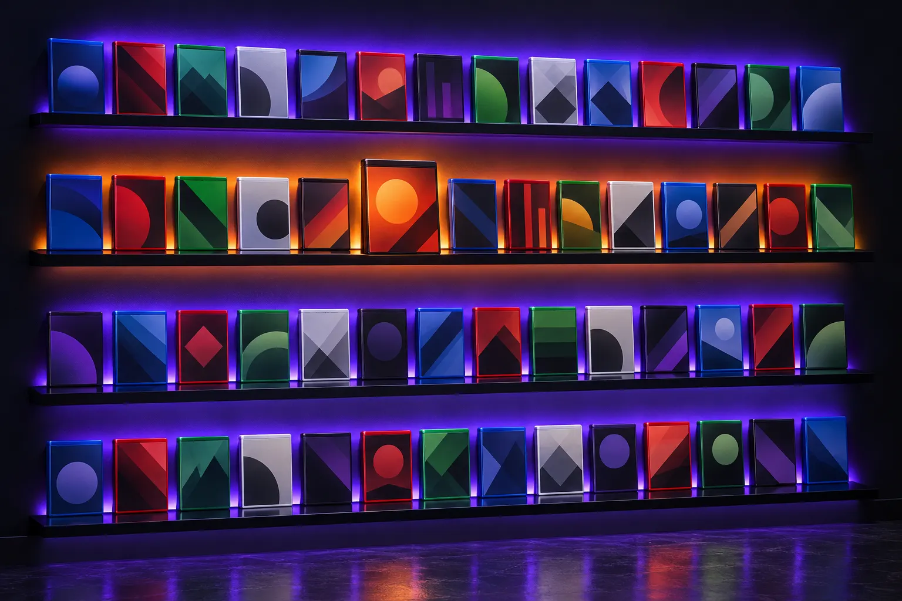
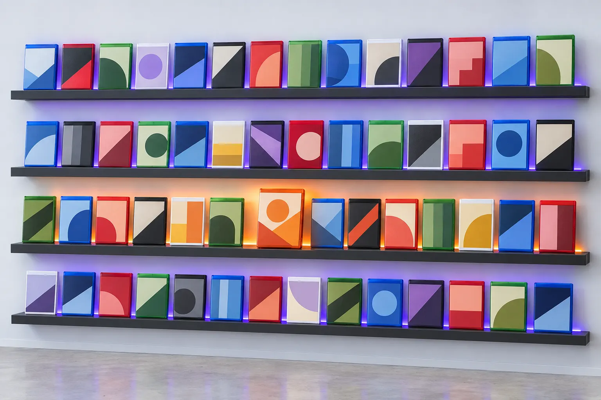

# ADR 002: Visual direction and how games stand on the shelf

- **Status:** accepted
- **Date:** 12 Oct 2026
- **Replaces:** the recommendation in [the research, section 7](../research.md#7-recommendation)
- **Changes:** [the spec](../spec.md), sections 3, 9, 13 and 14

## What happened

Phase 1 offered three directions and recommended **A. Vitrine**: a museum's open storage,
deep green and brass, a serif for titles, games standing spine-out on ledges. It was approved
unseen, twice, as "the recommended one".

At build step 1 it was on screen for the first time, and it was rejected:

> This looks too much a library of books then a library of games. Even the colors look like
> books. We need something that is gamer focused. Not book focused.

That reading is correct, and it has three causes:

| Cause | Why it reads as books |
| --- | --- |
| Games stood spine-out | A row of narrow colored spines is what a bookshelf looks like. IGDB has no spine art, so the spines would be generated color bars with a title: closer still to books. |
| A serif for titles | Serif titles on a quiet page are a publisher's or a museum's voice |
| Deep green and brass | A reading room's palette |

There was a mistake behind those. All three Phase 1 directions were furniture and rooms
(museum, living room, rental shop), and the research deliberately kept away from anything
that looked like a gaming interface, to be far from the old app's neon. "Far from the old
app" was allowed to outrank "looks like games".

## Decision

Two choices, both made by the owner from the options put to him.

### 1. Direction D: Backlit

A game room's display wall. Black shelves, each with an LED bar along its back edge. The
games stand in front of the light, so every cover is backlit.

**The light takes the color of the game in focus.** At rest it is violet. Point at a game and
its shelf glides to that game's own color, which is already stored for every game (three
colors are read from each cover when it is added). The games still supply the color; now they
supply the light as well.

| | Lights off (dark) | Lights on (light) |
| --- | --- | --- |
| Wall | `#0B0D12` near-black, cool | `#ECEEF2` pale cool gray |
| Surface | `#14171F` | `#F7F8FA` |
| Raised surface | `#1C202B` | `#FFFFFF` |
| Shelf | `#14171F`, seen by its LED line | `#1B1E27` black on the pale wall |
| Text | `#F2F4F8` | `#0E1014` |
| Secondary text | `#A3ABBB` | `#555C6B` |
| Accent (buttons, links, focus) | `#A796FF` | `#5B3FE6` |
| Marker for "playing" | `#4ADE80` | `#0A6B3A` |
| LED at rest | `#7C5CFF` | `#7C5CFF` |
| Light | The LEDs carry the room | Daylight; each LED is a thin line and a faint tint |

Every text pair passes WCAG AA, and a unit test fails the build if one stops passing. Because
the LED can be any color, the same test checks the worst case: text on a wall washed by white
light in the dark theme, and by no light in the pale one.

**Type.** [Archivo](https://fonts.google.com/specimen/Archivo) throughout: a wide, heavy cut
for titles and the regular width for the interface. [Martian Mono](https://fonts.google.com/specimen/Martian+Mono)
for numbers, counts and small labels, set as capitals, like a read-out. No serif anywhere.

**Motion.** Quick and exact, like a console's home screen: a game in focus comes toward you
and glows; the light glides to its color; panels snap in and settle. The five lengths from the
spec stay (100, 180, 280, 480 and 800 ms). Still nothing bounces.

**A theme is still a lighting state.** Lights on, lights off. Changing theme fades one light
down and brings the other up over about a second.

The concept images were generated with Codex. The cases carry abstract placeholder art only.
Prompts are in [`design/assets/PROMPTS.md`](../../design/assets/PROMPTS.md).

### 2. Covers face out

On the shelf, games stand with their covers toward you. Standing them spine-out becomes the
**compact** option, for seeing more of a large library at once.

| | Before | Now |
| --- | --- | --- |
| Default on the shelf | Spine-out | Cover-out |
| Spine-out | The only way | A compact option, per device, like 2D and 3D |
| What makes a case a game case | The spine's platform band | The whole case: its real shape, its plastic color, the band across its top |
| In focus | Tips forward from the top | Comes toward you and glows in its own color; its shelf's light takes that color |

Cases keep their real shapes and proportions, which is what tells a Switch game from a
PlayStation one at a glance: a Blu-ray case is 135 by 171 mm, a Switch case 105 by 170, a
keep case 135 by 190, a jewel case 142 by 125.

## What this changes

| Where | Change |
| --- | --- |
| Spec 3.2 | "Face-out" is the default, not a mark of a featured game. "Spine" describes the compact option. State marks are redrawn for covers (below). |
| Spec 3.3, 3.4 | Hover, focus and pull are described for covers. Light follows the game in focus. Scrubbing along a ledge belongs to the compact option. |
| Spec 3.6 | A second per-device choice next to 2D and 3D: covers or spines |
| Spec 9 | The lighting table is lights on and lights off |
| Spec 13 | The focus ring is the accent color, not brass |
| Spec 14 | Motion's character; the lengths are unchanged |
| Research 6 and 7 | Kept as a record. Section 7 points here. |
| Architecture 11, 13, 14 | Tokens, type, and what the 2D and 3D shelves draw |

**State marks, redrawn for a cover-out shelf.** Never by color alone:

| State | On the shelf |
| --- | --- |
| Backlog | Stands in the row |
| Playing | Stands forward of the row, and its shelf's label carries a "playing" marker |
| Completed | A small foil seal on the cover's corner |
| Dropped | Leans against its neighbor |
| Wishlist | An outlined placeholder with a faint cover, not a solid case |
| Owned only digitally | A cover with no case around it |
| Owned on more than one platform | A small count on the case's foot |

## What does not change

The data model, the filters, sorting, grouping, the address as state, both languages, access,
and everything in the architecture below the design tokens. The design tokens were built in
three layers (palette, meaning, lighting) so that a change like this one stays in a few files.

## Consequences

- **More covers on screen at once means more image requests.** A cover-out shelf shows
  perhaps 12 games a row where a spine-out one showed 40. The row is still virtual: only
  covers near the screen are requested. The compact option is there for density.
- **The 3D shelf draws covers at every distance**, not spines. The three levels of cover
  detail in the architecture stay; the nearest level simply applies to more boxes. The frame
  budget is measured at build step 4 as planned.
- **The light is a strong effect and needs a calm version.** Under reduced motion the light
  changes color at once and nothing moves.
- **Violet is the resting accent.** It is close to the color of several gaming brands. That is
  accepted: the accent is one token, and the light spends most of its time in a game's color.

## What I would do differently

Show real pixels before asking for a choice. Six concept renders and three paragraphs each
were not enough to tell what the product would feel like; one page built with the real tokens
was. From here on, anything that changes how Shelf looks is shown as a running page.
