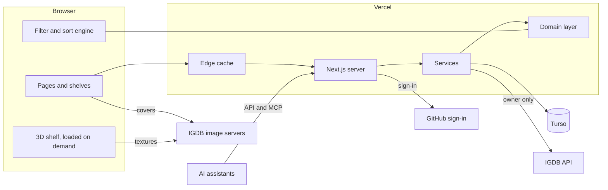

# Shelf: architecture

- **Status:** proposed, awaiting approval
- **Date:** 12 Oct 2026. Every version and limit below was checked on that day.
- **Reads with:** [the spec](spec.md), [ADR 001](adr/001-game-entry-model.md), [the setup checklist](setup.md)

This document says how Shelf is built: which tools, how the code is laid out, how a page gets
to the screen, and how the quality bar is enforced. The spec says what the product does; this
says how.

How to read the evidence labels:

| Label | Meaning |
| --- | --- |
| **Tested** | I ran it on this machine in a throwaway project |
| **Docs** | Read in the vendor's current documentation or the package registry |
| **To prove** | A design I expect to work, with the build step where it gets proven and a fallback |

## Contents

1. [The stack in one table](#1-the-stack-in-one-table)
2. [Where this differs from the brief](#2-where-this-differs-from-the-brief)
3. [Services and their free limits](#3-services-and-their-free-limits)
4. [How the pieces fit](#4-how-the-pieces-fit)
5. [Code layout](#5-code-layout)
6. [Rendering and caching](#6-rendering-and-caching)
7. [Data](#7-data)
8. [IGDB](#8-igdb)
9. [Sign-in and access](#9-sign-in-and-access)
10. [Languages](#10-languages)
11. [Themes and design tokens](#11-themes-and-design-tokens)
12. [Motion](#12-motion)
13. [The 2D shelf](#13-the-2d-shelf)
14. [The 3D shelf](#14-the-3d-shelf)
15. [Filters and sorting](#15-filters-and-sorting)
16. [API, MCP and machine-readable pages](#16-api-mcp-and-machine-readable-pages)
17. [Testing](#17-testing)
18. [Continuous integration](#18-continuous-integration)
19. [Performance budgets](#19-performance-budgets)
20. [Security](#20-security)
21. [Environments and settings](#21-environments-and-settings)
22. [What each build step adds](#22-what-each-build-step-adds)
23. [Risks and fallbacks](#23-risks-and-fallbacks)
24. [Sources](#24-sources)

---

## 1. The stack in one table

| Layer | Choice | Version | Evidence |
| --- | --- | --- | --- |
| Language | TypeScript, strict | 6.0.3 | Tested |
| Runtime | Node.js | 24 (LTS) | Docs |
| Package manager | pnpm | 10.34 | Docs |
| Framework | Next.js, App Router, Cache Components on | 16.4.0 | Tested |
| UI library | React | 19.3.0 | Tested |
| Automatic memoization | React Compiler | 1.0 | Docs |
| Styling | Tailwind CSS | 4.3 | Docs |
| Components | shadcn/ui on Radix primitives, restyled | shadcn 4.21, radix-ui 1.8 | Docs |
| Interface motion | Motion | 14.1 | Docs |
| Scroll scenes | GSAP with ScrollTrigger, and Lenis | 3.15, 1.3 | Docs |
| Page transitions | React `<ViewTransition>` | in React 19.3 | Docs |
| 3D | three.js, React Three Fiber, drei | 0.186, 9.8, 10.7 | Docs |
| Address state | nuqs | 2.10 | Docs |
| Client data | TanStack Query, TanStack Virtual | 5.104, 3.14 | Docs |
| Validation | Zod | 4.6 | Docs |
| Database | Turso (libSQL); a SQLite file locally | @libsql/client 0.18 | Docs |
| Database access | Drizzle | orm 0.45, kit 0.31 | Docs |
| Sign-in | Better Auth | 1.7 | Docs |
| Languages | next-intl | 4.14 | Docs |
| Themes | A small module of our own | none | Docs |
| MCP | mcp-handler on the MCP SDK | 2.3 on 2.3 | Docs |
| Unit and component tests | Vitest, Testing Library | 5.0, 16.3 | Docs |
| End-to-end tests | Playwright, with axe | 1.64, 4.13 | Docs |
| IGDB test double | MSW | 3.0 | Tested |
| Component workshop | Storybook | 10.6 | Docs |
| Lint | ESLint, with Next's rules | 10.12 | Tested |
| Format | Prettier | 3.9 | Docs |
| Hosting | Vercel, Hobby plan | n/a | Docs |
| CI | GitHub Actions | n/a | Docs |

**What "Tested" covered.** A throwaway project with Next.js 16.4, React 19.3, TypeScript 6.0.3,
ESLint 10.12 and MSW 3.0 on Node 24:

- ESLint 10 runs Next's own rule set, and the accessibility rule for a missing `alt` fires.
- `tsc` and `next build` pass with Cache Components on.
- MSW, started from Next's `instrumentation.ts`, intercepts a server-side request to
  `api.igdb.com` in a production build. With the switch off, the same request reaches the real
  IGDB and gets its 401. So tests can never be quietly talking to the live service, and
  production can never be quietly talking to a mock.

The throwaway project is deleted. Nothing from it is in the repository.

---

## 2. Where this differs from the brief

The brief said to check current versions and not rely on memory. Eight checks changed the plan.

| # | Brief | Decision | Why |
| --- | --- | --- | --- |
| 1 | TypeScript, latest | **6.0.3**, not 7.0.2 | TypeScript 7 is the new native compiler and has no programmatic API yet. `typescript-eslint`, which Next's lint rules depend on, declares `typescript <6.1.0`. The API is expected in 7.1. Moving up later is a one-line change. |
| 2 | Auth.js "or best equivalent" | **Better Auth** | The Auth.js site now reads "The Auth.js project is now part of Better Auth". `next-auth` 5 never left beta; its stable line is still 4. Better Auth is the maintained successor, and it also supplies the two extras this project needs: sign-in on preview deployments, and OAuth for the MCP server. |
| 3 | next-themes "or equivalent" | **Our own module**, about 80 lines | next-themes last shipped in March 2025. On React 19 with Next 16.2 and later it logs "Encountered a script tag while rendering React component" to the console, and the brief requires a clean console. What it does is small: one inline script and one hook. |
| 4 | pnpm, latest | **10.34**, not 12.11 | Vercel's build picks pnpm from the lockfile and lists 6 through 10 as supported. Anything newer needs Corepack switched on for the project, which is one more thing to manage. pnpm 10 is still released (10.34.7 came out on 12 Oct 2026). |
| 5 | Node, latest | **24**, not 26 | Vercel offers 24 (its default) and 22. |
| 6 | Drizzle, latest | **0.45**, not 1.0 | 1.0 is a release candidate (`1.0.0-rc.4`). 0.45 is the stable line. |
| 7 | "Covers via IGDB CDN with srcset" | As asked, and **not** through Vercel's image optimizer | The Hobby plan includes 5,000 image transformations a month. A 1,000-game library in three sizes would spend that in one visit. IGDB's servers already resize, send WebP, allow cross-origin use and cache for a year. The reference app's own notes record 0.24s direct against 1.20s through an optimizer. |
| 8 | CI runs everything | Everything runs, in **two tiers** | A private repository gets 2,000 free minutes a month. The full browser matrix on every push would not fit. See [section 18](#18-continuous-integration). |

Three things in the brief were confirmed as written and need no change: Tailwind 4 with
shadcn/ui and Radix; React Three Fiber with drei (it accepts React 19.3); MSW for IGDB.

One correction to my own memory: a GitHub OAuth app now accepts **up to 10** callback
addresses, not one. That simplifies the setup, but preview deployments still get a new address
each time, so they sign in through production ([section 9](#9-sign-in-and-access)).

---

## 3. Services and their free limits

| Service | Free allowance (checked 12 Oct 2026) | What Shelf uses | At the limit |
| --- | --- | --- | --- |
| **Vercel Hobby** | 100 GB transfer, 1,000,000 function calls, 4 CPU-hours, 5,000 image transformations a month. 100 deployments a day. Functions up to 300s. One function region. Scheduled jobs once a day. Non-commercial use only. | A few thousand function calls a month. No image transformations. One daily job. | The feature pauses until the 30-day window rolls over. There is no bill. |
| **Turso Free** | 100 databases, 5 GB, 500 million rows read and 10 million rows written a month. Point-in-time restore for 1 day. No card needed. | Two databases, a few megabytes. A cold start reads about 10,000 rows. | No bill unless overages are switched on, and they are off unless I turn them on. The pricing page does not say what happens to requests past the limit. |
| **GitHub Actions** | 2,000 minutes and 500 MB of artifacts a month for private repositories. Unlimited for public ones. | About 1,400 minutes in a busy build month ([section 18](#18-continuous-integration)). | Runs are blocked until next month. No bill without a payment method. |
| **GitHub OAuth** | Free. Up to 10 callback addresses per app. | Two apps: production and local. | n/a |
| **IGDB, through Twitch** | Free for non-commercial use. 4 requests a second, 8 open at once, 500 results a request. | A few requests when I add a game. Two a day for refresh. Visitors cause none. | A 429 response; the client waits and retries. |
| **Google Fonts** | Free. | Fonts are downloaded at build time and served from our own domain. | n/a |

Three rules of the Hobby plan shape the design:

- **The commit author must be the Vercel account owner.** Vercel compares the commit's author
  with the GitHub account linked to the Vercel account. Commits here are authored as
  `ldallacqua`, so that holds. A commit authored by a bot would not deploy. This is why the
  screenshot-baseline job hands me files to commit and does not commit them itself.
- **One function region.** Turso's documented locations are Virginia, Ohio, Oregon, Ireland,
  Mumbai and Tokyo; none is in South America. The function and the database both go in
  Virginia (`iad1` and `aws-us-east-1`), next to each other. A visitor in Brazil still gets the page
  frame from a nearby Vercel edge; only the data round trip goes to Virginia.
- **Preview deployments ask for a Vercel login.** This is Vercel's standard protection. On
  your phone you sign in to Vercel once and previews open. The setup checklist shows where
  the switch is.

---

## 4. How the pieces fit



Three flows matter.

**Reading the library.** The browser asks for `/en/library`. Vercel's edge answers at once with
the page frame, which is built ahead of time. The server then streams the first screen of
boxes into that frame, already filtered by whatever the address says. The browser fetches the
whole library as one compact file, and from then on every filter, sort and regroup happens on
the device with no request at all.

**Adding a game.** I type; the server asks IGDB (only for me, never for a visitor) and returns
matches. I pick one; the server fetches the full record and its relatives, works out the
grouping proposal from ADR 001, stores the IGDB data in our database, writes the entry and
copies, and marks the cached library as out of date. The next read rebuilds it.

**An assistant.** It reads through the public API or the public MCP endpoint with the same
filter language a person types. To add or change, it signs in through the same GitHub account
the interface uses.

The same code answers all three. The browser, the server pages, the API and the MCP server all
call one domain layer, so they cannot disagree about what a filter means.

---

## 5. Code layout

```text
src/
  domain/      Rules and types. No React, no Next.js, no database.
  server/      Runs only on the server: database, IGDB, sign-in, services.
  features/    The interface, by feature.
  ui/          Design-system parts: buttons, sheets, menus, tokens.
  app/         Routes. Thin: they compose features and call services.
  i18n/        Language setup.
messages/      en.json, pt-BR.json
fixtures/      IGDB data for tests and previews
e2e/           Playwright tests and reference screenshots
drizzle/       Database migrations, as SQL
scripts/       Seed, checks, measurements
design/        Tokens source, generated art and its prompts
docs/          This folder
```

| Folder | Holds | May import |
| --- | --- | --- |
| `domain/` | `library` (entries, copies, grouping rules), `query` (the filter language: parse, evaluate, write back out), `sort`, `group`, `facets`, `stats`, `spine` (colors and layout of a generated spine), `igdb` (turning IGDB records into ours) | Nothing but Zod |
| `server/` | `db` (Drizzle schema and client), `igdb` (the client), `auth`, `services` (every read and write), `mocks` (test doubles) | `domain` |
| `features/` | `library`, `shelf-2d`, `shelf-3d`, `wall`, `list`, `filters`, `add-game`, `game-detail`, `trophies`, `landing`, `theme`, `language` | `domain`, `ui`, and server actions |
| `ui/` | Restyled shadcn components, icons, tokens | Nothing of ours |
| `app/` | Pages, layouts, route handlers, server actions | Everything |

Lint rules enforce the table: `domain` cannot import React, Next or `server`; nothing outside
`features/shelf-3d` can import three.js; nothing in the browser bundle can import `server`
(`server-only` makes that a build error).

**One place for writes.** A server action, an API route and an MCP tool all call the same
function in `server/services`. That function checks who is asking, validates the input with
Zod, applies the rule from `domain`, writes in one transaction, and invalidates the cache.
There is no second path to the database.

---

## 6. Rendering and caching

Next.js 16.4 with **Cache Components** on. A page is a frame built ahead of time, plus parts
that are either cached or streamed per request. This is the default for new Next.js apps.

| Address | Built ahead | Per request | Refreshed when |
| --- | --- | --- | --- |
| `/en` (landing) | Whole page, including live library numbers | Nothing | The library changes |
| `/en/library` | Header, toolbar, shelf skeleton | The first screen of boxes for this address's filters | The library changes |
| `/en/shelves/{name}` | Whole first screen, per saved shelf | Nothing | The library or that shelf changes |
| `/en/trophies` | Whole page | Nothing | The library changes |
| `/en/game/{slug}` | Whole page, built on first visit and kept | Nothing for visitors. My private notes, for me only. | That game changes |
| `/en/sign-in` | Whole page | Nothing | Never |
| `/llms.txt`, `/sitemap.xml`, `/robots.txt` | Whole file | Nothing | The library changes |

**How "the library changes" works.** Every cached read is tagged `library` (and
`entry:{id}` for one game). Every write ends by expiring the tags: `updateTag` in a server
action, so I see my own change at once; `revalidateTag` in an API route.

**The library file.** The browser needs every game to filter on the device. It gets them as a
separate file, not inside the page:

| | |
| --- | --- |
| Address | `/api/v1/library/snapshot/{version}` |
| Version | A counter in the database, raised by one inside every write |
| Caching | The address changes when the content does, so the file is cached for a year by the edge and by the browser. A return visit downloads nothing unless I changed the library. |
| Contents | Per game: ids, title, status, rating, dates, playtime, year, IGDB rating, time to beat, cover id, three colors, a 25-byte blur hash, copies, and the ids of its genres, themes, modes, perspectives, platforms, franchises, series, studios and tags. Plus one name table per kind. |
| Left out | Summaries, screenshots and notes (the game page fetches those). Keywords, which are large, are a second file fetched the first time a keyword filter is used. Private notes are never in any public file. |
| Size target | 120 KB compressed per 1,000 games. A test fails the build past that. |

**Address state.** `q`, `sort`, `group`, `view` and `seed` are read and written with nuqs,
typed by the same Zod schemas the server uses. Changing a filter updates the address without
asking the server. Back and forward work because each change is a history entry.

**What stays out of the server's view.** Theme, language choice and the 2D or 3D preference
live in the browser (local storage). Reading them on the server would force every page to be
built per request. A short inline script applies them before the first paint
([section 11](#11-themes-and-design-tokens)).

---

## 7. Data

ADR 001 decides the model. This section decides how it is stored.

**Engine.** Turso in production and preview, reached over HTTP. A SQLite file
(`.data/shelf.db`) on this machine and in CI. Both speak the same SQL through the same client
library, so there is one schema and one set of migrations.

**Conventions**

| Topic | Rule |
| --- | --- |
| Ids | Text, from `crypto.randomUUID()`, created by the app |
| Times | Whole milliseconds since 1970, UTC. Dates without a time (completed on) are `YYYY-MM-DD` text. |
| Rating | Whole number 0 to 100. The interface shows it out of ten in half steps. |
| Playtime | Whole minutes |
| Enumerations | Text with a `CHECK` constraint, and a matching Zod schema |
| IGDB lists (genres, themes and so on) | JSON arrays of IGDB ids on the `games` row, with name tables alongside. They are read whole and filtered in memory, never joined. |
| Deleting | Real deletes, cascading from the entry. No soft delete. |

**Tables beyond ADR 001**

| Table | Purpose |
| --- | --- |
| `vocab` | Names for IGDB ids: kind, id, name, slug |
| `shelves` | Saved smart shelves: slug, name, query text, sort, group, position |
| `library_meta` | The version counter |
| `igdb_token` | The current Twitch token and its expiry |
| `user`, `session`, `account`, `verification` | Better Auth's own |
| `oauth*` (five tables) | Better Auth's, for MCP sign-in |

**Indexes** go on what is looked up one row at a time: `games.igdb_id`, `games.slug`,
`entry_versions.game_id`, `copies.entry_id`. The library itself is always read whole.

**Migrations.** Drizzle generates SQL files into `drizzle/`; they are committed and reviewed.
They are applied by `pnpm db:migrate`:

| Where | When |
| --- | --- |
| This machine | Before `pnpm dev` |
| CI | Before the build, on a fresh file |
| Preview and production | As the first step of the Vercel build, against that environment's database |

A deployment that is still serving keeps running during a migration, so every migration must
be safe for the previous version of the code: add first, remove in a later release.

**Three data sets**, loaded by `pnpm seed`:

| Name | What | Used by |
| --- | --- | --- |
| `default` | About 200 real, varied IGDB games with realistic statuses, copies, ratings and tags | Local work, tests, preview deployments |
| `empty` | No entries | The empty-library screens |
| `stress` | 1,000 or more games | Speed tests, virtual lists, 3D budgets |

`pnpm fixtures:fetch` is the only thing that talks to the real IGDB. I run it by hand; it
writes JSON into `fixtures/`, which is committed. The repository is private, and IGDB's terms
allow caching. If the repository is ever made public, the fixtures need another look.

**Production starts empty.** The real library is whatever I add after step 7.

---

## 8. IGDB

One module, `server/igdb`, is the only code that knows IGDB's address.

| Concern | Design |
| --- | --- |
| Credentials | `TWITCH_CLIENT_ID` and `TWITCH_CLIENT_SECRET`, read on the server only |
| Token | Twitch's client-credentials grant. Stored in the database with its expiry, so a cold server does not ask for a new one. Renewed a day before it expires, or at once on a 401. Concurrent callers share one renewal. |
| Rate | A queue that sends at most 4 requests a second with at most 4 in flight. On a 429 it waits and retries, twice. |
| Who can trigger it | Only me. Search, add, bulk add and refresh all require my session. A visitor cannot spend the allowance. |
| Search | `search` for the typeahead, with editions hidden and ports folded as the spec says. Results cached for a day by normalized text. |
| Bulk add | IGDB's multi-query: 10 lookups a request, matching by name (Phase 2 found that `search` returns nothing inside a multi-query). 200 lines is 20 requests. |
| Adding | One request for the record with everything expanded, one for its relatives. Stored in `games` before the entry is written. |
| Reading | The library never calls IGDB. Everything shown comes from our database. |
| Refresh | A daily job re-fetches the 100 records checked longest ago: 2 requests. A 1,000-game library is never more than 10 days stale. I can also refresh one game by hand. |
| Validation | Every IGDB response passes a Zod schema before anything else touches it. A record that fails is logged and skipped, not half-stored. |
| Terms | Non-commercial use under the Twitch Developer Service Agreement. "IGDB.com" is credited in the footer of every page. |

**Images** come straight from `images.igdb.com`:

| Use | IGDB size | Pixels |
| --- | --- | --- |
| List row, 3D far atlas | `cover_small` | 90 × 128 |
| Shelf, wall | `cover_big`, with `cover_big_2x` for sharp screens | 264 × 374 |
| Detail, pulled box | `720p` | up to 720 high |
| Screenshots | `screenshot_med`, `screenshot_big`, `screenshot_huge` | 569, 889, 1280 wide |

- Always WebP. IGDB's servers return an error for AVIF, so there is no AVIF step.
- One helper builds the address and the `srcset`. Every image carries its width and height, so
  nothing shifts as it loads.
- **Placeholder.** When a game is added, the server reads its cover once and stores three
  dominant colors and a ThumbHash (about 25 bytes). The colors paint the generated spine and
  the box behind the cover. The hash becomes a blurred preview until the real cover arrives.
- The page opens a connection to `images.igdb.com` early, and the first row of covers is
  marked high priority.

---

## 9. Sign-in and access

**Library:** Better Auth 1.7, with its Drizzle adapter on the same database.

| Concern | Design |
| --- | --- |
| Provider | GitHub only |
| Who gets in | One account. `OWNER_GITHUB_ID` holds its numeric id, which never changes (a username can). |
| Turning others away | At sign-in: a GitHub profile whose id is not the owner's is refused before any account is stored, and the person sees a plain message. Better Auth's "before" hooks can abort a sign-up; the exact hook is settled at step 7, and the test (a second account cannot sign in) is the contract. |
| Every write | `requireOwner()` runs first in every service function that changes anything. It loads the session and compares its GitHub id with `OWNER_GITHUB_ID` again. The sign-in check is a courtesy; this one is the lock. |
| Sessions | A row in the database and a cookie that scripts cannot read, sent only over HTTPS, with SameSite=Lax. Seven days, extended on use. |
| Visitors | Carry no cookie, so they cost no session lookups |
| Edit controls | Rendered only after the browser confirms a session. A second, harmless cookie (`shelf_owner_hint`) tells the page whether it is worth asking; visitors never trigger the question. |
| Private notes | Never in a cached page or the library file. Fetched by a separate request that requires the session. |
| Preview deployments | Better Auth's OAuth Proxy: a preview sends the GitHub round trip through production, which hands the result back encrypted. Only the production callback is registered with GitHub. The preview keeps its own database, so signing in there cannot touch the real library. |
| Local work | A second GitHub OAuth app whose callback is `http://localhost:3300/api/auth/callback/github` |

The callback path is the same everywhere: `/api/auth/callback/github`.

**In tests,** nothing bypasses sign-in. The server's calls to GitHub are answered by MSW, and
Playwright redirects the browser's trip to `github.com` straight back to the callback. That
exercises the real code, including a second account being refused. One sign-in is saved and
reused by the tests that need me to be signed in.

---

## 10. Languages

**Library:** next-intl 4.14.

| Concern | Design |
| --- | --- |
| Addresses | Always prefixed: `/en/…`, `/pt-BR/…` |
| First visit to `/` | `proxy.ts` (Next 16's name for middleware) reads `Accept-Language`: Portuguese goes to `/pt-BR`, everything else to `/en` |
| Remembering | The switcher stores the choice in a cookie that `proxy.ts` honors on later visits to `/` |
| Static pages | Both languages are built ahead for every page, through Next's root parameters |
| Text | `messages/en.json` and `messages/pt-BR.json`, split by feature. English is the source. Keys are typed, so a misspelled key is a type error. |
| Plurals, numbers, dates | ICU messages and the browser's `Intl`, by locale |
| Alphabetical order | `Intl.Collator` for the active language, computed once per language |
| IGDB text | Shown as provided. Inside a Portuguese page it is wrapped in `lang="en"`. |
| Filter keys | English in both languages. They are a syntax, not prose. |

Two checks fail the build: `pnpm i18n:check` (a key present in one file and missing in the
other), and a lint rule that rejects literal text inside interface components.

---

## 11. Themes and design tokens

**Tokens** are CSS custom properties, declared once and mapped into Tailwind 4's `@theme`.
There are three layers:

| Layer | Example | Changes with theme |
| --- | --- | --- |
| Palette | `--green-900: #17231F` | No |
| Meaning | `--wall`, `--ledge`, `--surface`, `--text`, `--brass`, `--marker` | Yes |
| Lighting | `--light-color`, `--light-spread`, `--shadow-length`, `--shadow-depth`, `--reflect` | Yes |

The lighting layer is what makes a theme "a lighting state, not an inversion" (spec, section
9). The 2D shelf reads it as CSS: shadows, gradients, glow. The 3D shelf reads the same
properties from the page and feeds them to its materials and lights. So there is one source,
and the two shelves cannot drift.

Values come from the chosen direction. Vitrine's palette, type and pace are in
[the research](research.md#6-three-visual-directions); step 1 turns them into the token file.

**The theme module** (ours, replacing next-themes):

- An inline script in the page head, rendered by the server, runs before the first paint. It
  reads the stored choice (`light`, `dark` or `system`), resolves `system` against the
  device, and sets `data-theme` on the root element. No flash, and the page stays cacheable.
- The same script sets `data-shelf-mode` from the stored 2D or 3D preference, so a desktop
  that prefers 3D never flashes the 2D shelf first.
- A hook exposes the theme and a setter, and follows the device when the choice is `system`.
- Changing theme sets a short-lived attribute that lets the lighting properties animate for
  about a second. Under reduced motion the change is immediate.

**Components.** shadcn/ui copies component source into `src/ui`, built on Radix primitives
for focus handling, keyboard support and screen-reader roles. Every one is restyled with the
tokens; none keeps its stock look. Sheets, dialogs, menus, tooltips, tabs, the command
palette and toasts come from this set.

**Type.** Newsreader (titles) and Archivo (interface and spines), as variable fonts through
`next/font`: downloaded at build time, served from our domain, subset to Latin, preloaded,
with fallback metrics so text does not jump when the font arrives.

---

## 12. Motion

One tool per job, so nothing fights:

| Job | Tool | Loaded |
| --- | --- | --- |
| Hover, press, focus, simple state | CSS transitions | Always |
| Sheets, menus, reordering after a sort, gestures | Motion | With the library |
| A cover growing into the detail page | React `<ViewTransition>` | Built in |
| Scroll-driven scenes | GSAP with ScrollTrigger | Landing page only |
| Smooth scrolling | Lenis | Landing page only, and not on touch |
| Anything inside the 3D scene | The render loop, with damping | With 3D only |

**Durations and curves** are tokens (100, 180, 280, 480, 800 ms), shared by CSS, Motion and
the 3D scene.

**Reduced motion** is one decision, read in one place. Every animation asks it and has a
written calm version from the spec: a crossfade, or nothing. Lenis does not start, GSAP scenes
show their end state, the camera cuts.

**Reordering 1,000 boxes.** Only boxes on screen animate. The rest jump, unseen.

**Shared-element transitions** follow the current Next.js guidance: the same `name` on the
cover in the shelf and on the detail page, `share="morph"` with `default="none"`, about 400
ms. Browsers without the feature get the page change without the animation.

---

## 13. The 2D shelf

Built from ordinary page elements, which is what makes it the accessible and searchable
baseline.

| Concern | Design |
| --- | --- |
| Spines | Real elements: real text for the title, colors from the stored palette, a platform band. A screen reader reads them and a browser can find text in them. |
| Tip-out, pull, lean | CSS 3D transforms on the box |
| Depth | Three layers moved by scroll position, about 12 px, with a CSS scroll timeline where supported |
| Long libraries | Ledges are rows in a virtual list (TanStack Virtual). Only rows near the screen exist in the page. |
| First paint | The server renders the first screen of real boxes, so covers start loading with the page |
| Phone | One shelf per screen with sideways scroll snapping; tabs for the same move |
| Wall and List | The same data and selection through different row renderers. List is a real table. |

---

## 14. The 3D shelf

**Loading.** The whole 3D feature is one separate bundle, fetched only when 3D mode is active
and the device can run it. A CI check fails if three.js appears in the library page's initial
code.

**When it is used.** Desktop by default; never under reduced motion; never without WebGL 2.
If the context is lost or the frame rate collapses, the page returns to 2D and says so once.

**Scene**

| Concern | Design |
| --- | --- |
| Boxes | One instanced mesh per case shape (about ten shapes). A thousand games is about ten draw calls. |
| Per-box data | Position, tilt, state (resting, hovered, pulled, dimmed) and texture coordinates, as instance attributes |
| Spines | Drawn at runtime on a canvas from title, colors and platform, in the same font as the 2D spines, into texture atlases built for the bays near the camera |
| Covers | Three levels: none (spine only), `cover_small` in atlases for boxes in view, `cover_big` for the nearest dozen and the pulled box |
| Light | No real-time shadows. Contact shadows and pools of light are textures and shader terms driven by the lighting tokens. |
| Frames | Drawn only when something changes. An idle shelf uses no GPU. |
| Resolution | Capped at 1.75× and lowered automatically if frames run slow |
| Picking | By arithmetic: boxes sit on known ledges, so a pointer ray meets the shelf plane and a search finds the box. No per-box hit testing. |
| Camera | Our own rig: walks sideways along the wall, damped, driven by scroll, drag and keys |

**Accessibility.** The canvas is hidden from assistive technology. Beside it sits the same
library as a labeled list with the same order and selection. Focus in the list moves the
camera; a click in the scene moves focus in the list. Keyboard and screen-reader users operate
the list and see the scene follow.

**Budgets** (checked in tests through a small debug hook that exists only in test builds)

| Measure | Budget |
| --- | --- |
| Draw calls, 1,000 games | Under 40 |
| Texture memory | Under 256 MB |
| Frame time on the reference laptop, 500 games | Under 16.7 ms, measured by `pnpm perf:3d` |
| 3D bundle, compressed | Under 300 KB |

CI can count draw calls and textures. It cannot measure a real frame rate, because it has no
real GPU. The 60 frames a second target is measured on this machine and reported with numbers
at steps 4 and 9.

---

## 15. Filters and sorting

All in `domain/`, written **tests first** at step 5.

```text
text ──parse──▶ tree ──compile──▶ predicate over an index ──▶ matching games
  ▲                │
  └────write───────┘   (the panel edits the tree; the address stores the text)
```

| Part | Design |
| --- | --- |
| Parser | Hand-written, recursive descent, for the language in spec section 5.3. Never throws: bad input becomes a tree plus a list of problems, each with a position, so the field can underline it. |
| Tree | `and`, `or`, `not`, and terms: a key, an operator, values |
| Writer | Tree back to canonical text. Parse then write then parse gives the same tree; a property test generates thousands of random queries to prove it. |
| Index | Built once when the library file loads. For each value of each filter (each genre, each platform, each status) a bitmap with one bit per game. |
| Evaluation | `and`, `or` and `not` become bitwise operations on whole bitmaps. Ranges (year, rating, hours) scan a typed array. |
| Facet counts | For each visible value: count the bits it shares with the current result. A few hundred counts over a thousand games takes well under a millisecond. |
| Sorting | Sort keys are computed once per language. Missing values sort last, ties by title. Random uses a seeded generator, so a shared address shuffles the same way. |
| Grouping | A function from the sorted result to shelves. A game with copies on two platforms appears in both and is counted once. |

**Target:** a filter or sort change over 1,000 games in under 50 ms, including facet counts. A
benchmark in the unit tests runs the stress data set and fails past the budget.

The server runs the same code for the first screen, the API and the MCP tools.

---

## 16. API, MCP and machine-readable pages

**API**, under `/api/v1`. Every request and response has a Zod schema; the OpenAPI document is
generated from them, so it cannot drift from the code.

| Method and path | Who | Does |
| --- | --- | --- |
| `GET /library?q&sort&group&limit&cursor` | Anyone | The library, filtered, sorted and grouped |
| `GET /library/facets?q` | Anyone | Available filter values, with counts |
| `GET /library/snapshot/{version}` | Anyone | The whole library file |
| `GET /games/{slug}` | Anyone | One game, with public notes |
| `GET /shelves`, `GET /shelves/{slug}` | Anyone | Smart shelves |
| `GET /openapi.json` | Anyone | The API's own description |
| `GET /igdb/search?q` | Me | Search IGDB |
| `POST /entries`, `PATCH /entries/{id}`, `DELETE /entries/{id}` | Me | Add, change, remove |
| `POST /entries/bulk` | Me | Add from a pasted list |
| `PUT /shelves/{slug}`, `DELETE /shelves/{slug}` | Me | Save or remove a smart shelf |

The interface itself uses server actions for writes; these routes are the same services with
an HTTP face. `docs/api.md` is written alongside at step 5.

**MCP**, on the current specification (2026-07-28), stateless:

| Endpoint | Sign-in | Tools |
| --- | --- | --- |
| `/api/mcp` | None | `search_library`, `get_game`, `list_filter_values`, `list_shelves` |
| `/api/mcp/owner` | OAuth through Better Auth's MCP plugin, which signs me in with the same GitHub account | The four above, plus `search_igdb`, `add_game`, `update_entry`, `set_status` |

There are two endpoints because, in practice, an assistant only starts a sign-in when a
server demands one. A single endpoint that allowed anonymous reads would never get to offer
the write tools.

**For crawlers and assistants**

- `/llms.txt`: what the site is, the API, both MCP endpoints, and the filter language with
  examples.
- Structured data (JSON-LD) on every public page: `WebSite` on the landing page,
  `CollectionPage` with an `ItemList` on the library, `VideoGame` on each game page.
- `sitemap.xml` with both languages and `hreflang` links; `robots.txt` allowing public pages.

---

## 17. Testing

| Layer | Tool | Covers | Runs |
| --- | --- | --- | --- |
| Unit | Vitest, Node | All of `domain`: parser, evaluator, sort, group, facets, grouping rules, spine colors, IGDB mapping. Services against an in-memory SQLite. The IGDB client against MSW. | Locally and in CI, in seconds |
| Property | fast-check in Vitest | The filter language round trip; sorting is a total order | With unit |
| Component | Vitest with jsdom and Testing Library | Components with real logic: filter panel, add-game form, sort menu, sheets. Keyboard paths and labels, in both languages. | With unit |
| End to end | Playwright | Every "Done when" line in the spec that a browser can check | CI; affected files locally |
| Parity | Playwright | Each library scenario runs twice, 2D and 3D, asserting the same games, order, selection and address. Plus the switch itself. | CI |
| Visual | Playwright screenshots | Key screens × light and dark × English and Portuguese × phone and desktop | CI |
| Accessibility | axe inside Playwright | Every page and every open sheet or dialog, both themes | CI |
| Speed | Lighthouse 13, scripted | Landing and library on the mobile profile: 90 or more, and the Core Web Vitals in spec section 16 | CI |

**Browser matrix:** Chromium, Firefox and WebKit, each at phone (390), tablet (820) and
desktop (1440). Nine projects.

**IGDB is never live in a test.** With `SHELF_MOCKS=1` the server starts MSW from
`instrumentation.ts`, serving `fixtures/` for the IGDB, Twitch and GitHub addresses, and
treating any other request to those hosts as an error. The mocks refuse to start on Vercel.
In the browser, Playwright answers requests to `images.igdb.com` with small generated covers
(a color field and the title), so no test depends on IGDB's image servers and the repository
holds no real cover art.

**Reference screenshots** are made on Linux in CI, because fonts render differently on a Mac.
A manual workflow renders new ones and offers them as a download; I commit them under my own
name (a bot's commit would not deploy on Vercel's Hobby plan).

**3D in tests.** Parity tests assert on meaning (which games, what order, what is selected),
not pixels. 3D screenshots use a fixed camera, no animation and a looser match. Where a CI
browser cannot create a WebGL context, the app's own fallback to 2D runs, and the test asserts
that fallback, which the spec requires anyway.

**On this machine** I run unit and component tests freely, and only the Playwright files a
change touches, one project at a time. The full matrix runs in CI. That is because of this
Mac's load problem, not a shortcut on coverage.

**Storybook** holds every `ui` component and the main feature components in their states,
with toolbar switches for theme and language and the accessibility panel on.

---

## 18. Continuous integration

Free minutes are finite (2,000 a month while the repository is private), so the pipeline has
two tiers. Both run before anything merges.

| Tier | When | Jobs | About |
| --- | --- | --- | --- |
| **Every push** | Each push to a pull request | Format, lint, typecheck, translation check, unit and component tests, build, bundle checks. End-to-end smoke: Chromium at phone and desktop. | 10 min |
| **Full** | When a pull request is marked ready for review, on every push to `main`, and on demand | All nine browser projects, split across three runners. Visual, accessibility and parity suites. Lighthouse. Storybook build. | 40 min |

A newer push cancels the run before it. Dependencies, the Next.js build cache and Playwright's
browsers are cached between runs.

**Budget.** Ten pull requests, each with about six pushes and two full runs: 10 × (6 × 10 + 2
× 40) = 1,400 minutes, with room for reruns. If the repository became public, minutes would be
unlimited and the full tier could run on every push.

**"Done" for a build step** means the full tier is green on the step's last commit, and the
summary carries screenshots at phone and desktop in both themes, taken by Playwright.

CI needs **no secrets**: it builds against a SQLite file and the mocks.

---

## 19. Performance budgets

| Measure | Budget | Enforced by |
| --- | --- | --- |
| Library page JavaScript, first load, compressed | 180 KB | Build check |
| three.js in any page's first load | None | Build check |
| Landing page JavaScript before scroll scenes load | 130 KB | Build check |
| Library file per 1,000 games, compressed | 120 KB | Unit test |
| Filter or sort, 1,000 games | 50 ms | Unit benchmark |
| Lighthouse mobile, landing and library | 90 | CI |
| Largest contentful paint, mobile | 2.5 s | CI |
| Layout shift | 0.1 | CI |
| Rows in the page for a 1,000-game list | Only those near the screen | End-to-end test |
| Fonts | Two families, variable, Latin subset, preloaded | Review |

How the page gets fast: the frame comes from the edge with no server work; the first screen
of boxes is in the HTML, so covers begin loading at once; the library file is cached by
content; nothing 3D loads on a phone; images have their dimensions and a placeholder, so
nothing moves.

The React Compiler is on. It memoizes components automatically, which matters most for a long
list reacting to filter changes.

---

## 20. Security

| Concern | Design |
| --- | --- |
| Secrets | In `.env.local` here and in Vercel's settings in production. Never in git, logs, summaries or chat. `.env.example` holds names only. |
| Server-only code | `server-only` turns an accidental import into the browser bundle into a build error |
| Input | Zod at every boundary: address parameters, forms, API bodies, MCP arguments, IGDB responses, environment variables at startup |
| Writes | `requireOwner()` in every service function ([section 9](#9-sign-in-and-access)). A test walks every write route and action without a session and expects a refusal. |
| Cross-site requests | Server actions check the request's origin (built into Next.js). Session cookies are SameSite=Lax. API writes need the session or an OAuth token. |
| Database | Drizzle's query builder throughout; no SQL assembled from input |
| Content from IGDB | Rendered as text. Never inserted as HTML. |
| Headers | `Content-Security-Policy` limiting scripts and connections to our own origin and images to ours plus `images.igdb.com`; `frame-ancestors 'none'`; `X-Content-Type-Options`; a strict `Referrer-Policy`; a `Permissions-Policy` that switches off what we do not use |
| Abuse | Public endpoints only read, and the heavy ones are cached at the edge. IGDB is unreachable without my session. The worst outcome of a flood on the free plan is a paused site, not a bill. |
| Test doubles | Start only when `SHELF_MOCKS=1`, and refuse to start when Vercel's environment is detected |

One honest limit: the strictest form of Content Security Policy needs a fresh random value in
every response, which is incompatible with pages built ahead of time. Shelf keeps fast static
pages and allows inline scripts from our own HTML. Next.js has an experimental
integrity-hash alternative; I will try it at step 9 and adopt it if it holds up.

---

## 21. Environments and settings

| | Local | CI | Preview | Production |
| --- | --- | --- | --- | --- |
| Address | `http://localhost:3300` | Local to the runner | A new `*.vercel.app` per push | `https://shelf-ldallacqua.vercel.app` (proposed) |
| Database | `.data/shelf.db` | A fresh file | Turso `shelf-preview` | Turso `shelf` |
| Data | `default`, or any set | `default` and `stress` | `default`, loaded if empty | Mine |
| IGDB | Live for me; mocked with `SHELF_MOCKS=1` | Mocked | Live, when I add | Live, when I add |
| Sign-in | The local GitHub app | Mocked GitHub | Through production (OAuth Proxy) | The production GitHub app |
| Who can open it | Me | n/a | Me, signed in to Vercel | Everyone |

**Settings** (names only; values are yours to paste):

| Name | For | First needed |
| --- | --- | --- |
| `TWITCH_CLIENT_ID` | IGDB | Local: now, already set. Vercel: step 7. |
| `TWITCH_CLIENT_SECRET` | IGDB | Same |
| `TURSO_DATABASE_URL` | Database | Vercel: step 2 |
| `TURSO_AUTH_TOKEN` | Database | Vercel: step 2 |
| `BETTER_AUTH_SECRET` | Signing sessions | Step 7 |
| `GITHUB_CLIENT_ID` | GitHub sign-in | Step 7 |
| `GITHUB_CLIENT_SECRET` | GitHub sign-in | Step 7 |
| `OAUTH_PROXY_SECRET` | Sign-in on previews | Step 7 |
| `OWNER_GITHUB_ID` | The one allowed account | Step 7 |
| `CRON_SECRET` | The daily refresh job | Step 9 |

The site's own address comes from Vercel's built-in `VERCEL_PROJECT_PRODUCTION_URL`, so there
is nothing to set for it, and sign-in uses the same value. At startup the server validates every setting with Zod and stops
with a message naming what is missing (the name, never the value).

[The setup checklist](setup.md) has the click-by-click steps.

---

## 22. What each build step adds

| Step | Adds | From you ([checklist](setup.md)) |
| --- | --- | --- |
| **1** Scaffold ⏸ | Next.js app, strict TypeScript, lint and format, Tailwind and tokens for the chosen direction, the theme module, both languages, Storybook, the test runners, CI, `AGENTS.md` and `CLAUDE.md` | Create the Vercel project |
| **2** IGDB and data | Drizzle schema and migrations, the IGDB client with mocks, services, the three data sets, the library file | Create two Turso databases; two settings, each with a preview and a production value |
| **3** 2D shelf ⏸ | Shelf, Wall and List; virtual lists; images and placeholders; motion in both themes | Nothing |
| **4** 3D shelf ⏸ | The 3D bundle, the switch, parity tests, fallback | Nothing |
| **5** Filters and sorting | The query language (tests first), index, facets, panel, smart shelves, public API, `docs/api.md` | Nothing |
| **6** Game detail | Detail page and overlay, shared-element transitions, JSON-LD for games | Nothing |
| **7** Sign-in and adding | Better Auth, owner guard, add and bulk add, edit, write API, both MCP endpoints | Two GitHub OAuth apps; seven settings |
| **8** Landing page ⏸ | Landing page, scroll scenes, generated art, OG image, `llms.txt`, sitemap | Nothing |
| **9** Passes | Phone and tablet polish, accessibility audit, speed work, the daily refresh, security headers | One setting |
| **10** Review | Walkthrough with screenshots and video, known gaps | Nothing |

Two notes on order:

- **Smart shelves are saved at step 5, but sign-in arrives at step 7.** Saving is built and
  tested at step 5 (tests sign in through the mock). On a deployed preview you can save
  shelves once step 7 lands.
- **The domain layer starts at step 2 and grows.** The API and MCP server are thin faces on
  it, which is why they are cheap to add at steps 5 and 7.

---

## 23. Risks and fallbacks

| # | Risk | Likelihood | Fallback |
| --- | --- | --- | --- |
| 1 | CI browsers without a GPU cannot run the 3D shelf well, especially WebKit | High | Parity tests assert meaning, not pixels. Where WebGL is missing, the test asserts the 2D fallback. Frame rate is measured here, on real hardware. |
| 2 | Better Auth's MCP plugin and current assistants disagree on the newest sign-in details | Medium | A personal access token I create while signed in, accepted by the owner endpoint. Same account, simpler handshake. |
| 3 | Vercel refuses a deployment over commit authorship (for example, the co-author line on my commits) | Low; the documented check is on the author | Drop the co-author line, or deploy from GitHub Actions with a Vercel token |
| 4 | next-intl's use of Next's new root parameters has an edge case with Cache Components | Low | next-intl's older `setRequestLocale` path, which it still supports |
| 5 | `<ViewTransition>` behaves differently in Safari or Firefox | Medium | It is an enhancement. Without it, the page changes with a crossfade. |
| 6 | GitHub Actions minutes run out mid-month | Medium in a heavy month | Fewer full runs; or make the repository public |
| 7 | Texture memory is too high on an older laptop | Medium | Smaller atlases and fewer cover levels, chosen automatically from measured frame time |
| 8 | Two open branches migrate the shared preview database differently | Low; work is one branch at a time | `pnpm db:reset:preview` rebuilds it from fixtures |
| 9 | The page frame is instant but the first boxes take a cold-start round trip to Virginia | Medium | Keep a ready-made copy of the library file in the database, rebuilt on each write, so a cold start is one read |
| 10 | TypeScript 7.1 or typescript-eslint support lands mid-build | Certain, eventually | Upgrade between steps, never inside one |
| 11 | Preview sign-in depends on a secret shared between preview and production | Accepted | Previews only ever run my own code from a private repository |

---

## 24. Sources

Checked on 12 Oct 2026.

**Registry.** Versions, release dates and peer requirements for every package in
[section 1](#1-the-stack-in-one-table) were read from the npm registry with `npm view`.

**Next.js 16.4 documentation**

- [Caching (Cache Components)](https://nextjs.org/docs/app/getting-started/caching)
- [Revalidating](https://nextjs.org/docs/app/getting-started/revalidating)
- [View transitions](https://nextjs.org/docs/app/guides/view-transitions)
- [TypeScript, including TypeScript 7](https://nextjs.org/docs/app/api-reference/config/typescript)
- [proxy.ts](https://nextjs.org/docs/app/api-reference/file-conventions/proxy)
- [React Compiler](https://nextjs.org/docs/app/api-reference/config/next-config-js/reactCompiler)
- [Content Security Policy](https://nextjs.org/docs/app/guides/content-security-policy)

**Vercel**

- [Hobby plan](https://vercel.com/docs/plans/hobby)
- [Project collaboration and commit authors](https://vercel.com/docs/deployments/troubleshoot-project-collaboration)
- [Function regions](https://vercel.com/docs/functions/configuring-functions/region)
- [Node.js versions](https://vercel.com/docs/functions/runtimes/node-js/node-js-versions)
- [Package managers](https://vercel.com/docs/package-managers)
- [Scheduled jobs](https://vercel.com/docs/cron-jobs/usage-and-pricing)
- [Deployment protection](https://vercel.com/docs/deployment-protection) and
  [its bypass for automation](https://vercel.com/docs/deployment-protection/methods-to-bypass-deployment-protection/protection-bypass-automation)

**Turso**

- [Pricing](https://turso.tech/pricing)
- [Locations](https://docs.turso.tech/api-reference/locations/list.md)
- [With Vercel](https://docs.turso.tech/integrations/vercel.md)
- [With Drizzle](https://docs.turso.tech/sdk/ts/orm/drizzle.md)

**Sign-in**

- [Auth.js, now part of Better Auth](https://authjs.dev/getting-started)
- Better Auth: [GitHub](https://better-auth.com/docs/authentication/github),
  [sessions](https://better-auth.com/docs/concepts/session-management),
  [Next.js](https://better-auth.com/docs/integrations/next),
  [database hooks](https://better-auth.com/docs/concepts/database),
  [Drizzle adapter](https://better-auth.com/docs/adapters/drizzle),
  [OAuth Proxy](https://better-auth.com/docs/plugins/oauth-proxy),
  [MCP](https://better-auth.com/docs/plugins/mcp)
- [GitHub: creating an OAuth app](https://docs.github.com/en/apps/oauth-apps/building-oauth-apps/creating-an-oauth-app)

**Other**

- [GitHub Actions billing](https://docs.github.com/en/billing/concepts/product-billing/github-actions)
- [next-intl routing setup](https://next-intl.dev/docs/routing/setup)
- [MSW 2 to 3 migration](https://mswjs.io/docs/migrations/2.x-to-3.x)
- [MCP TypeScript SDK](https://github.com/modelcontextprotocol/typescript-sdk) and the
  `mcp-handler` 2.3 README
- [GSAP standard license](https://gsap.com/community/standard-license/)
- TypeScript 7 and tooling:
  [InfoQ](https://infoq.com/news/2026/08/typescript-7-released/),
  [Microsoft's release-candidate post](https://devblogs.microsoft.com/typescript/announcing-typescript-7-0-rc/)
- next-themes on React 19:
  [issue 385](https://github.com/pacocoursey/next-themes/issues/385),
  [issue 387](https://github.com/pacocoursey/next-themes/issues/387)
- IGDB limits, image sizes and terms: [the research](research.md), Phase 1
