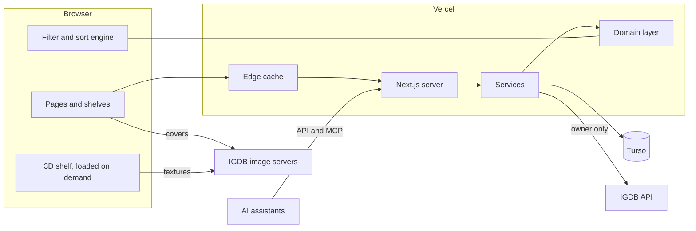

# Shelf: architecture

- **Status:** approved. Changes made while building are listed in [section 25](#25-changes-since-approval).
- **Date:** 12 Oct 2026. Every version and limit below was checked on that day.
- **Reads with:** [the spec](spec.md), [ADR 001](adr/001-game-entry-model.md), [the setup checklist](setup.md)

This document says how Shelf is built: which tools, how the code is laid out, how a page gets
to the screen, and how the quality bar is enforced. The spec says what the product does; this
says how.

How to read the evidence labels:

| Label | Meaning |
| --- | --- |
| **Tested** | I ran it on this machine in a throwaway project |
| **Docs** | Read in the vendor's current documentation or the package registry |
| **To prove** | A design I expect to work, with the build step where it gets proven and a fallback |

## Contents

1. [The stack in one table](#1-the-stack-in-one-table)
2. [Where this differs from the brief](#2-where-this-differs-from-the-brief)
3. [Services and their free limits](#3-services-and-their-free-limits)
4. [How the pieces fit](#4-how-the-pieces-fit)
5. [Code layout](#5-code-layout)
6. [Rendering and caching](#6-rendering-and-caching)
7. [Data](#7-data)
8. [IGDB](#8-igdb)
9. [Sign-in and access](#9-sign-in-and-access)
10. [Languages](#10-languages)
11. [Themes and design tokens](#11-themes-and-design-tokens)
12. [Motion](#12-motion)
13. [The 2D shelf](#13-the-2d-shelf)
14. [The 3D shelf](#14-the-3d-shelf)
15. [Filters and sorting](#15-filters-and-sorting)
16. [API, MCP and machine-readable pages](#16-api-mcp-and-machine-readable-pages)
17. [Testing](#17-testing)
18. [Continuous integration](#18-continuous-integration)
19. [Performance budgets](#19-performance-budgets)
20. [Security](#20-security)
21. [Environments and settings](#21-environments-and-settings)
22. [What each build step adds](#22-what-each-build-step-adds)
23. [Risks and fallbacks](#23-risks-and-fallbacks)
24. [Sources](#24-sources)
25. [Changes since approval](#25-changes-since-approval)

---

## 1. The stack in one table

| Layer | Choice | Version | Evidence |
| --- | --- | --- | --- |
| Language | TypeScript, strict | 6.0.3 | Tested |
| Runtime | Node.js | 24 (LTS) | Docs |
| Package manager | pnpm | 10.34 | Docs |
| Framework | Next.js, App Router, Cache Components on | 16.4.0 | Tested |
| UI library | React | 19.3.0 | Tested |
| Automatic memoization | React Compiler | 1.0 | Docs |
| Styling | Tailwind CSS | 4.3 | Docs |
| Components | shadcn/ui on Radix primitives, restyled | shadcn 4.21, radix-ui 1.8 | Docs |
| Interface motion | Motion | 14.1 | Docs |
| Scroll scenes | GSAP with ScrollTrigger, and Lenis | 3.15, 1.3 | Docs |
| Page transitions | React `<ViewTransition>` | in React 19.3 | Docs |
| 3D | three.js, on its own (no React Three Fiber, no drei: see section 2, row 9) | 0.186.1 | Docs |
| Address state | nuqs | 2.10 | Docs |
| Client data | TanStack Query, TanStack Virtual | 5.104, 3.14 | Docs |
| Validation | Zod | 4.6 | Docs |
| Database | Turso (libSQL); a SQLite file locally | @libsql/client 0.18 | Docs |
| Database access | Drizzle | orm 0.45, kit 0.31 | Docs |
| Sign-in | Better Auth; its MCP, CIMD and JWT plugins for assistants | 1.7 | Tested |
| Languages | next-intl | 4.14 | Docs |
| Themes | A small module of our own | none | Docs |
| MCP | The MCP SDK's own handler (`@modelcontextprotocol/server`) | 2.3 | Tested |
| Unit and component tests | Vitest, Testing Library | 5.0, 16.3 | Docs |
| End-to-end tests | Playwright, with axe | 1.64, 4.13 | Docs |
| IGDB test double | MSW | 3.0 | Tested |
| Component workshop | Storybook | 10.6 | Docs |
| Lint | ESLint, with Next's rules | 10.12 | Tested |
| Format | Prettier | 3.9 | Docs |
| Hosting | Vercel, Hobby plan | n/a | Docs |
| CI | GitHub Actions | n/a | Docs |

**What "Tested" covered.** A throwaway project with Next.js 16.4, React 19.3, TypeScript 6.0.3,
ESLint 10.12 and MSW 3.0 on Node 24:

- ESLint 10 runs Next's own rule set, and the accessibility rule for a missing `alt` fires.
- `tsc` and `next build` pass with Cache Components on.
- MSW, started from Next's `instrumentation.ts`, intercepts a server-side request to
  `api.igdb.com` in a production build. With the switch off, the same request reaches the real
  IGDB and gets its 401. So tests can never be quietly talking to the live service, and
  production can never be quietly talking to a mock.

The throwaway project is deleted. Nothing from it is in the repository.

---

## 2. Where this differs from the brief

The brief said to check current versions and not rely on memory. Eight checks changed the plan, and one measurement at step 4.

| # | Brief | Decision | Why |
| --- | --- | --- | --- |
| 1 | TypeScript, latest | **6.0.3**, not 7.0.2 | TypeScript 7 is the new native compiler and has no programmatic API yet. `typescript-eslint`, which Next's lint rules depend on, declares `typescript <6.1.0`. The API is expected in 7.1. Moving up later is a one-line change. |
| 2 | Auth.js "or best equivalent" | **Better Auth** | The Auth.js site now reads "The Auth.js project is now part of Better Auth". `next-auth` 5 never left beta; its stable line is still 4. Better Auth is the maintained successor, and it also supplies the two extras this project needs: sign-in on preview deployments, and OAuth for the MCP server. |
| 3 | next-themes "or equivalent" | **Our own module**, about 80 lines | next-themes last shipped in March 2025. On React 19 with Next 16.2 and later it logs "Encountered a script tag while rendering React component" to the console, and the brief requires a clean console. What it does is small: one inline script and one hook. |
| 4 | pnpm, latest | **10.34**, not 12.11 | Vercel's build picks pnpm from the lockfile and lists 6 through 10 as supported. Anything newer needs Corepack switched on for the project, which is one more thing to manage. pnpm 10 is still released (10.34.7 came out on 12 Oct 2026). |
| 5 | Node, latest | **24**, not 26 | Vercel offers 24 (its default) and 22. |
| 6 | Drizzle, latest | **0.45**, not 1.0 | 1.0 is a release candidate (`1.0.0-rc.4`). 0.45 is the stable line. |
| 7 | "Covers via IGDB CDN with srcset" | As asked, and **not** through Vercel's image optimizer | The Hobby plan includes 5,000 image transformations a month. A 1,000-game library in three sizes would spend that in one visit. IGDB's servers already resize, send WebP, allow cross-origin use and cache for a year. The reference app's own notes record 0.24s direct against 1.20s through an optimizer. |
| 8 | CI runs everything | Everything runs, **locally before each merge** (`pnpm verify`); CI only by hand | A private repository gets 2,000 free minutes a month, and one full run took about 75. It began as two tiers on GitHub; at the end of step 3 the owner asked for the checks to run locally instead, before each push, and after step 7 once before each merge, so the long run does not hold work up. See [section 18](#18-continuous-integration). |
| 9 | React Three Fiber with drei | **three.js on its own**, driven from one React component (the owner's decision at step 4, 14 Oct 2026) | Measured, compressed, React aside: three.js with only the classes the shelf uses is 129 KB; R3F's `<Canvas>` registers all of three.js, 242 KB; R3F with `createRoot` and a chosen set, 183 KB. The scene is imperative anyway (instanced boxes, our own shaders, camera and picking, frames on demand), so R3F's 54 KB would buy little. drei was never needed. The 3D bundle is 147 KB of its 300. |

Three things in the brief were confirmed as written at the start: Tailwind 4 with shadcn/ui
and Radix; React Three Fiber with drei (it accepts React 19.3), later replaced (row 9); MSW
for IGDB.

Sign-in was planned as GitHub; since 21 Oct 2026 it is one account with an email address and
password ([section 9](#9-sign-in-and-access)).

---

## 3. Services and their free limits

| Service | Free allowance (checked 12 Oct 2026) | What Shelf uses | At the limit |
| --- | --- | --- | --- |
| **Vercel Hobby** | 100 GB transfer, 1,000,000 function calls, 4 CPU-hours, 5,000 image transformations a month. 100 deployments a day. Functions up to 300s. One function region. Scheduled jobs once a day. Non-commercial use only. | A few thousand function calls a month. No image transformations. One daily job. | The feature pauses until the 30-day window rolls over. There is no bill. |
| **Turso Free** | 100 databases, 5 GB, 500 million rows read and 10 million rows written a month. Point-in-time restore for 1 day. No card needed. | Two databases, a few megabytes. A cold start reads about 10,000 rows. | No bill unless overages are switched on, and they are off unless I turn them on. The pricing page does not say what happens to requests past the limit. |
| **GitHub Actions** | 2,000 minutes and 500 MB of artifacts a month for private repositories. Unlimited for public ones. | About 1,400 minutes in a busy build month ([section 18](#18-continuous-integration)). | Runs are blocked until next month. No bill without a payment method. |
| **IGDB, through Twitch** | Free for non-commercial use. 4 requests a second, 8 open at once, 500 results a request. | A few requests when I add a game. Two a day for refresh. Visitors cause none. | A 429 response; the client waits and retries. |
| **Google Fonts** | Free. | Fonts are downloaded at build time and served from our own domain. | n/a |

Three rules of the Hobby plan shape the design:

- **The commit author must be the Vercel account owner.** Vercel compares the commit's author
  with the GitHub account linked to the Vercel account. Commits here are authored as
  `ldallacqua`, so that holds. A commit authored by a bot would not deploy. This is why the
  screenshot-baseline job hands me files to commit and does not commit them itself.
- **One function region, next to the database: São Paulo** (`gru1` and `aws-sa-east-1`). The
  plan had both in Virginia, because Turso's documented locations had none in South America;
  the owner found São Paulo offered when creating the database (21 Oct 2026). Pages and the
  library file reach every visitor from a nearby Vercel edge; only the data round trip goes to
  São Paulo. The calls out to IGDB and Twitch cross to the US, and they come only when adding
  games.
- **Preview deployments ask for a Vercel login.** This is Vercel's standard protection. On
  your phone you sign in to Vercel once and previews open. The setup checklist shows where
  the switch is.

---

## 4. How the pieces fit



Three flows matter.

**Reading the library.** The browser asks for a shelf, `/en/u/lucas`. Vercel's edge answers at
once with the page frame, built on the shelf's first visit and kept. The server then streams the first screen of
boxes into that frame, already filtered by whatever the address says. The browser fetches the
whole library as one compact file, and from then on every filter, sort and regroup happens on
the device with no request at all.

**Adding a game.** I type; the server asks IGDB (only for me, never for a visitor) and returns
matches. I pick one; the server fetches the full record and its relatives, works out the
grouping proposal from ADR 001, stores the IGDB data in our database, writes the entry and
copies, and marks the cached library as out of date. The next read rebuilds it.

**An assistant.** It reads through the public API or the public MCP endpoint with the same
filter language a person types. To add or change, it signs in through the same account the
interface uses.

The same code answers all three. The browser, the server pages, the API and the MCP server all
call one domain layer, so they cannot disagree about what a filter means.

---

## 5. Code layout

```text
src/
  domain/      Rules and types. No React, no Next.js, no database.
  server/      Runs only on the server: database, IGDB, sign-in, services.
  features/    The interface, by feature.
  ui/          Design-system parts: buttons, sheets, menus, tokens.
  app/         Routes. Thin: they compose features and call services.
  i18n/        Language setup.
messages/      en.json, pt-BR.json
fixtures/      IGDB data for tests and previews
e2e/           Playwright tests and reference screenshots
drizzle/       Database migrations, as SQL
scripts/       Seed, checks, measurements
patches/       Small fixes to dependencies, each with its reason in pnpm-workspace.yaml
design/        Tokens source, generated art and its prompts
docs/          This folder
```

| Folder | Holds | May import |
| --- | --- | --- |
| `domain/` | `library` (entries, copies, grouping rules), `query` (the filter language: parse, evaluate, write back out), `sort`, `group`, `facets`, `stats`, `spine` (colors and layout of a generated spine), `igdb` (turning IGDB records into ours) | Nothing but Zod |
| `server/` | `db` (Drizzle schema and client), `igdb` (the client), `auth`, `services` (every read and write), `mocks` (test doubles) | `domain` |
| `features/` | `shell` (header, footer, empty and not-found states), `library`, `shelf-2d`, `shelf-3d`, `wall`, `list`, `filters`, `add-game`, `game-detail`, `trophies`, `landing`, `theme`, `language` | `domain`, `ui`, and server actions |
| `ui/` | Restyled shadcn components, the shelf and game-case parts, fonts, tokens | Nothing of ours |
| `app/` | Pages, layouts, route handlers, server actions | Everything |

Lint rules enforce the table: `domain` cannot import React, Next or `server`; nothing outside
`features/shelf-3d` can import three.js; nothing in the browser bundle can import `server`
(`server-only` makes that a build error).

**One place for writes.** A server action, an API route and an MCP tool all call the same
function in `server/services`. That function checks who is asking, validates the input with
Zod, applies the rule from `domain`, writes in one transaction, and invalidates the cache.
There is no second path to the database.

---

## 6. Rendering and caching

Next.js 16.4 with **Cache Components** on. A page is a frame built ahead of time, plus parts
that are either cached or streamed per request. This is the default for new Next.js apps.

| Address | Built ahead | Per request | Refreshed when |
| --- | --- | --- | --- |
| `/en` (landing) | Whole page | Nothing | Never |
| `/en/u/{handle}` | A frame per shelf, on its first visit: header, heading, and ghosts where the totals, the controls and the first boxes will be. A shelf with no account says so; a private one is a frame its own account fills ([ADR 004](adr/004-one-library-per-account.md)). | The first screen of boxes for this address's filter, sort and grouping, and the list of smart shelves | That library or its shelves change |
| `/en/u/{handle}/shelves/{name}` | The same frame with the shelf's name, on its first visit | The first screen for the shelf, with whatever the address changes | That library or its shelves change |
| `/en/u/{handle}/trophies` | Whole page, on its first visit. A private one is a frame its own account fills. | Nothing | That library changes, and once a day, for "this year" |
| `/en/u/{handle}/game/{slug}` | Whole page, on its first visit, and kept | Nothing. For the shelf's own account, "Mine" is then read from `GET /api/v1/entries/{id}`, private notes included. | That library changes |
| `/en/sign-in`, `/en/sign-up`, `/en/account`, `/en/consent` | Whole page | Nothing. Who is signed in is asked by the page, and the account page is filled by it. | Never |
| `/llms.txt`, `/sitemap.xml`, `/robots.txt` | Whole file | Nothing | The library changes |

No shelf is built ahead: each route's `generateStaticParams` names one reserved handle,
`none`, so Cache Components has a frame to build from, and every real shelf is built on its
first visit and kept.

**How "the library changes" works.** Every cached read is tagged with its library,
`library:{id}`, and a read by handle or file key also with `handle:{handle}` or `key:{key}`
(`src/server/services/tags.ts`). Every write ends by expiring its library's tag: `updateTag`
in a server action, so the account sees its own change at once; `revalidateTag` in an API
route. A change to the account (its name, handle or visibility) expires its handles too.

**Smart shelves are the exception.** They are not in the library file, so saving one does not
raise the library's version (which would make every visitor download the file again for
nothing in it). Shelf reads are tagged `shelves:{id}`, and a shelf write expires only that. A
shelf's page reads its shelf by slug (`getShelf`), cached on its own: an address Next.js did
not build is first answered from the route's prebuilt frame and the data cached with it,
and a list of shelves cached then would not know a shelf saved since.

**The library file.** The browser needs every game to filter on the device. It gets them as a
separate file, not inside the page:

| | |
| --- | --- |
| Address | `/api/v1/libraries/{key}/snapshot/{version}`. The key is random, per library, and changes when the shelf goes private, so an address that was public leads nowhere after. |
| Version | A counter per library (`libraries.version`), raised by one inside every write to it |
| Caching | The address changes when the content does, so the file is cached for a year by the edge and by the browser. A return visit downloads nothing unless the library changed. |
| Built | On its first request, then kept. Any other version's address is sent on to the current one. A private library has no file here: its own account reads `/api/v1/me/library`, uncached and private. |
| Contents | Per game: ids, title, status, rating, dates, playtime, year, IGDB rating, time to beat, cover id, three colors, a 25-byte blur hash, copies, and the ids of its genres, themes, modes, perspectives, platforms, franchises, series, studios and tags. Plus one name table per kind. |
| Left out | Summaries, screenshots and notes. A game opened over the shelf fetches them as its facts, `/api/v1/libraries/{key}/games/{version}/{slug}`, cached the same way; its own page has them inside it. Keywords, which are large, are a second file, `/api/v1/libraries/{key}/keywords/{version}`, fetched the first time a keyword filter is used, and cached the same way. Private notes are never in any public file. |
| Size target | 120 KB compressed per 1,000 games. A test fails the build past that. |

**Address state.** `q`, `sort`, `group`, `view` and `seed` are read and written with nuqs
(`view` and `group` since step 3, the rest since step 5). One function in `domain/` reads
them for the server and falls back to the default for anything it does not know, so a shared
address arrives drawn. Changing a filter updates the address without asking the server. Back
and forward work because each change is a history entry; a search being typed is one entry,
not one per letter. On a smart shelf, a parameter the address leaves out is the shelf's.

**What stays out of the server's view.** Theme, language choice and the 2D or 3D preference
live in the browser (local storage). Reading them on the server would force every page to be
built per request. A short inline script applies them before the first paint
([section 11](#11-themes-and-design-tokens)).

---

## 7. Data

ADR 001 decides the model. This section decides how it is stored.

**Engine.** Turso in production and preview, reached over HTTP. A SQLite file
(`.data/shelf.db`) on this machine and in CI. Both speak the same SQL through the same client
library, so there is one schema and one set of migrations.

A deployment with no Turso database connected does not fail. Its build makes the SQLite file
and ships it, and each server instance works on a copy: a preview shows the sample library,
production shows an empty one. Nothing written to that copy is kept, the server says so in its
log, and anything that saves my own data refuses to run on it
([section 25](#25-changes-since-approval)).

**Conventions**

| Topic | Rule |
| --- | --- |
| Ids | Text, from `crypto.randomUUID()`, created by the app |
| Times | Whole milliseconds since 1970, UTC. Dates without a time (completed on) are `YYYY-MM-DD` text. |
| Rating | Whole number 0 to 100. The interface shows it out of ten in half steps. |
| Playtime | Whole minutes |
| Enumerations | Text with a `CHECK` constraint, and a matching Zod schema |
| IGDB lists (genres, themes and so on) | JSON arrays of IGDB ids on the `games` row, with name tables alongside. They are read whole and filtered in memory, never joined. |
| A game's public address | The IGDB slug of its primary version, on its shelf: `/u/lucas/game/the-elder-scrolls-v-skyrim`. It is unique within a library, because a record belongs to one entry per library. Entry ids never leave the server. |
| Whose a row is | `user_id`, the account's id, on every row that is someone's: entries, entry versions, tags, smart shelves, removed games ([ADR 004](adr/004-one-library-per-account.md)). Every query on them is scoped by it. `games`, `vocab` and `platforms` are the shared IGDB cache. |
| Deleting | Real deletes, cascading from the entry. No soft delete. |

**Tables beyond ADR 001**

| Table | Purpose |
| --- | --- |
| `vocab` | Names for IGDB ids: kind, id, name, slug |
| `shelves` | Saved smart shelves: slug (unique per library), name, query text, sort, group, position |
| `libraries` | One row per account: its library's version counter, and the random key in its files' addresses |
| `library_meta` | The version counter from before accounts. Read once, by the migration that moved it into `libraries`; dropped later. |
| `igdb_token` | The current Twitch token and its expiry. One row. |
| `users`, `sessions`, `accounts`, `verifications` | Better Auth's own. `users` adds `username` (the handle) and `shelf_public`. |
| `oauth_*` (seven tables), `jwks` | Better Auth's, for assistants signing in to an account's MCP endpoint: clients, resources, tokens, consents; and the keys tokens are signed with |
| `removed_entries` | A removed game, whole, for a day, so Undo can put it back exactly |
| `rate_limits` | Sign-in and sign-up tries, and each account's hourly IGDB use |

**Indexes** go on what is looked up one row at a time: `games.igdb_id`, `games.slug`,
`entry_versions.game_id`, `copies.entry_id`. The library itself is always read whole.

**Two columns ADR 001 did not name.** `games.lineage` holds the chain of records above a
record in its family (the Switch port's is "port of 472"), worked out when the record is
fetched. The grouping rule reads it, so deciding whether a new game belongs with one on the
shelf needs no further request to IGDB. `platforms` carries our own `key` (what
`owned:ps5` matches), a short label, and the color of the case's plastic.

**Migrations.** Drizzle generates SQL files into `drizzle/`; they are committed and reviewed.
They are applied by `pnpm db:migrate`:

| Where | When | Command |
| --- | --- | --- |
| This machine | Before `pnpm dev` | `pnpm seed`, or `pnpm db:migrate` to keep the data |
| CI | Before the build, on a fresh file | `pnpm seed` |
| Preview and production | As the first step of the Vercel build, against that environment's database | `pnpm db:prepare`, from the `vercel-build` script |

A deployment that is still serving keeps running during a migration, so every migration must
be safe for the previous version of the code: add first, remove in a later release.

**Three data sets**, loaded by `pnpm seed` into the sample account's library (`/u/sample`, no
password; with the test doubles on, `MOCK_OWNER`'s). A seed replaces every library's games and
keeps every account:

| Name | What | Used by |
| --- | --- | --- |
| `default` | 230 real, varied IGDB games with realistic statuses, copies, ratings and tags | Local work, tests, preview deployments |
| `empty` | No entries | The empty-library screens |
| `stress` | The default set and 1,050 more: 1,280 games | Speed tests, virtual lists, 3D budgets |

The games are real. What "I" did with each one is invented, from the game's own id, so it
comes out the same on every run and a screenshot does not change between seeds. Two entries
are written by hand to exercise ADR 001: Skyrim with its Switch port (one entry, two copies),
and Shadow of the Tomb Raider with its Definitive Edition.

`pnpm fixtures:fetch` is the only thing that talks to the real IGDB. I run it by hand; it
writes JSON into `fixtures/`, which is committed. The repository is private, and IGDB's terms
allow caching. If the repository is ever made public, the fixtures need another look.

**Production starts empty.** The real library is whatever I add after step 7.

---

## 8. IGDB

One module, `server/igdb`, is the only code that knows IGDB's address.

| Concern | Design |
| --- | --- |
| Credentials | `TWITCH_CLIENT_ID` and `TWITCH_CLIENT_SECRET`, read on the server only |
| Token | Twitch's client-credentials grant. The secret travels in the request body, never in the address. Stored in the database with its expiry, so a cold server does not ask for a new one. Renewed a day before it expires, or at once on a 401. Concurrent callers share one renewal. |
| Rate | A queue that sends at most 4 requests a second with at most 4 in flight. On a 429 it waits and retries, twice. |
| Who can trigger it | Search, add and bulk add need an account's session, and each account spends only so much (`fair-use.ts`). The refresh answers only Vercel's daily call, with `CRON_SECRET`. A visitor cannot spend the allowance. |
| Search | `search` for the typeahead, with editions hidden and ports folded as the spec says. Results cached for a day by normalized text. |
| Bulk add | IGDB's multi-query: 10 lookups a request, matching by name (Phase 2 found that `search` returns nothing inside a multi-query). 200 lines is 20 requests. |
| Adding | One request for the record with everything expanded, one for its relatives. Stored in `games` before the entry is written. |
| Reading | The library never calls IGDB. Everything shown comes from our database. |
| Refresh | A daily job (`/api/cron/refresh`, called by Vercel with `CRON_SECRET`) asks again about the 100 records checked longest ago, across every library: their records and their times to beat, 2 requests. Only a record whose IGDB stamp or time to beat changed costs more (its family chain, new names, a new cover's colors); it is stored again at the address it had, and every library holding it gets a new version. A 1,000-record cache is never more than 10 days stale. A missed or repeated run does no harm: the next takes the next oldest. |
| Validation | Every IGDB response passes a Zod schema before anything else touches it. A record that fails is logged and skipped, not half-stored. |
| Terms | Non-commercial use under the Twitch Developer Service Agreement. "IGDB.com" is credited in the footer of every page. |

**Images** come straight from `images.igdb.com`:

| Use | IGDB size | Pixels |
| --- | --- | --- |
| List row | `cover_small` | 90 × 128 |
| Shelf, wall | `cover_big`, with `cover_big_2x` for sharp screens | 264 × 374 |
| 3D shelf | Whichever the 2D shelf takes on that screen (`cover_small_2x` or `cover_big`), redrawn at the size the box appears | 180 × 256 or 264 × 374 |
| 3D pulled box | `cover_big_2x` | 528 × 748 |
| Detail | `720p` | up to 720 high |
| Screenshots | `screenshot_med`, `screenshot_big`, `screenshot_huge` | 569, 889, 1280 wide |

- Always WebP. IGDB's servers return an error for AVIF, so there is no AVIF step.
- One helper builds the address and the `srcset`. Every image carries its width and height, so
  nothing shifts as it loads.
- **Placeholder.** When a game is added, the server reads its cover once and stores three
  dominant colors and a ThumbHash (about 25 bytes). The colors paint the generated spine and
  the box behind the cover. The hash becomes a blurred preview until the real cover arrives.
- The page opens a connection to `images.igdb.com` early, and the first row of covers is
  marked high priority.

---

## 9. Sign-in and access

**Library:** Better Auth 1.7, with its Drizzle adapter on the same database.

| Concern | Design |
| --- | --- |
| Provider | An email address and password (Better Auth's own), with its `username` plugin for the handle and sign-in by handle ([ADR 004](adr/004-one-library-per-account.md)) |
| Who gets in | Anyone who signs up: a name, a handle, an email address, a password of 10 to 128 characters, and public or private. A new account gets its library row and the starter shelves in the same request (`startLibrary`). No email is sent: no confirming, and no reset but `pnpm account:password` by hand. |
| Turning others away | A wrong password, or an unknown address or handle, gets the same plain message. Five tries at a password a minute from one address (sign-in, change of password, deleting the account), and three new accounts an hour, counted in the database (`rate_limits`), since a function's memory is gone between requests. |
| Every write | `requireAccount()` runs first in every service function that changes or privately reads anything, inside `forAccount()`, which hands the service the session's own account. The service works on that library only; a write never names one. Sign-in is one lock; this is the other. |
| Fairness | Beside IGDB's site-wide limit, each account may search 600 times, match 100 lists and add 300 games an hour (`fair-use.ts`). Past that, `too-many`. |
| Assistants | The MCP endpoint for one's own shelf takes OAuth access tokens, not the session cookie. Better Auth's MCP plugin is the authorization server: an assistant is known by its Client ID Metadata Document's address, its account signs in as on the site, and says yes on `/consent`. Tokens are JWTs signed with keys in the `jwks` table, for that endpoint only. The endpoint checks the token, loads its account (`accountOfUser`), and runs the tools inside `asAccount`, which `requireAccount()` honours. |
| Sessions | A row in the database and a cookie that scripts cannot read, sent only over HTTPS, with SameSite=Lax. Seven days, extended on use. |
| Visitors | Carry no cookie, so they cost no session lookups |
| Edit controls | Rendered only after the browser confirms a session, and only on the account's own shelf. A second, harmless cookie (`shelf_signed_in`) tells the page whether it is worth asking; visitors never trigger the question. |
| Private notes | Never in a cached page or the library file. Fetched by a separate request that requires the session: `GET /api/v1/entries/{id}`, which the editor reads, uncached and private. |
| Private shelves | Never drawn, cached or filed on the server. Their pages are frames; their own account's browser fills them from `/api/v1/me/library`, `/api/v1/me/games/{slug}`, `/keywords`, `/tags` and `/shelves`, each `private, no-store`. |
| Preview deployments | Sign up and in as production does, once they have a database of their own; until then nothing to sign in to. |
| Local work | `BETTER_AUTH_SECRET` in `.env.local`, with any value |

**In tests,** nothing bypasses sign-in. With the test doubles on, the seeded sample account
takes a made-up password (`MOCK_OWNER`) on the first sign-in, and the browser fills in the
real form. One sign-in is saved and reused by the tests that need the sample's shelf to be
one's own. Tests that need accounts of their own make them through the real sign-up, with
handles no other run can have. An assistant signs in the same way: MSW serves a test
assistant's metadata document, the browser signs in and says yes on the consent page, and the
test trades the code for a token and calls the tools with the official MCP client.

---

## 10. Languages

**Library:** next-intl 4.14.

| Concern | Design |
| --- | --- |
| Addresses | Always prefixed: `/en/…`, `/pt-BR/…` |
| First visit to `/` | `proxy.ts` (Next 16's name for middleware) reads `Accept-Language`: Portuguese goes to `/pt-BR`, everything else to `/en` |
| Remembering | The switcher stores the choice in a cookie that `proxy.ts` honors on later visits to `/` |
| Static pages | Both languages are built ahead for every page, through Next's root parameters |
| Text | `messages/en.json` and `messages/pt-BR.json`, split by feature. English is the source. Keys are typed, so a misspelled key is a type error. |
| Plurals, numbers, dates | ICU messages and the browser's `Intl`, by locale |
| Alphabetical order | `Intl.Collator` for the active language, computed once per language |
| IGDB text | Shown as provided. Inside a Portuguese page it is wrapped in `lang="en"`. |
| Filter keys | English in both languages. They are a syntax, not prose. |
| The list of pages | `src/i18n/routing.ts` names every page. Links are type-checked against it, and a test fails if it and `src/app` disagree. |
| An address with no page | `proxy.ts` answers 404 with that language's "not found" page as the body: complete HTML, right language and theme, before any JavaScript. See [section 25](#25-changes-since-approval) for why it is done there. |

Two checks fail the build: `pnpm i18n:check` (a key present in one file and missing in the
other), and a lint rule that rejects literal text inside interface components.

---

## 11. Themes and design tokens

**Tokens** are CSS custom properties, declared once and mapped into Tailwind 4's `@theme`.
There are three layers:

| Layer | Example | Changes with theme |
| --- | --- | --- |
| Palette | `--green-900: #17231F` | No |
| Meaning | `--wall`, `--ledge`, `--surface`, `--text`, `--accent`, `--marker` | Yes |
| Lighting | `--ambient`, `--led-strength`, `--led-wash`, `--shadow-length`, `--shadow-depth`, `--glow`, `--reflect` | Yes |
| The LED's color | `--led` | No: it follows the game in focus |

The lighting layer is what makes a theme "a lighting state, not an inversion" (spec, section
9). The 2D shelf reads it as CSS: shadows, gradients, glow. The 3D shelf reads the same
properties from the page and feeds them to its materials and lights. So there is one source,
and the two shelves cannot drift.

Values come from the direction, Backlit: its palette, type and pace are in
[ADR 002](adr/002-visual-direction.md), and `src/ui/tokens/` holds them.

Every token that changes with the theme, and `--led`, is registered as a typed CSS property
(`@property`). That is what lets a theme change, or the LED changing color, play as a glide
instead of a cut. A unit test reads the token files and fails if a text pair drops below its
contrast requirement, including text on a wall washed by an LED of any color.

**The theme module** (ours, replacing next-themes):

- An inline script in the page head, rendered by the server, runs before the first paint. It
  reads the stored choice (`light`, `dark` or `system`), resolves `system` against the
  device, and sets `data-theme` on the root element. No flash, and the page stays cacheable.
- The same script sets `data-shelf-mode` from the stored 2D or 3D preference, so a desktop
  that prefers 3D never flashes the 2D shelf first.
- A hook exposes the theme and a setter, and follows the device when the choice is `system`.
- Changing theme sets a short-lived attribute that lets the lighting properties animate for
  about a second. Under reduced motion the change is immediate.

**Components.** shadcn/ui copies component source into `src/ui`, built on Radix primitives
for focus handling, keyboard support and screen-reader roles. Every one is restyled with the
tokens; none keeps its stock look. Sheets, dialogs, menus, tooltips, tabs, the command
palette and toasts come from this set, and so do the form's controls: a select, a rating
slider, a calendar, a tag field, chips, checkboxes and switches, and one text field they
all look like. No form control is the browser's own drawing. The checkbox, radio button
and switch are the browser's inputs underneath, restyled, so they cost no script on the
pages visitors load.

**Type.** Archivo for titles and interface, Martian Mono for numbers and labels, through
`next/font`: served from our domain, subset to Latin, preloaded, with fallback metrics so
text does not jump when the font arrives. The preloads are tags at the top of `<head>`,
not a `Link` header (`reactMaxHeadersLength: 0` in `next.config.ts`): a shelf's page is
built again in the background after a change, and the header could be lost from that
build, which left the library painting in fallback fonts. Three small files, 58 KB together: Archivo at
normal width (34 KB), one wide, heavy style cut from Archivo for titles (13 KB), and one
weight of Martian Mono (11 KB). `src/ui/fonts/README.md` says how the title file was made.

---

## 12. Motion

One tool per job, so nothing fights:

| Job | Tool | Loaded |
| --- | --- | --- |
| Hover, press, focus, simple state | CSS transitions | Always |
| Menus and sheets | CSS animations on Radix primitives | With the library |
| Reordering after a regroup or a change of view | The Web Animations API: each box on screen slides from where it stood (`useFlip`) | With the library |
| Gestures: dragging a game's sheet between its two heights | Pointer events moving one custom property, `--sheet-drag`, written straight to the sheet; letting go eases it to a height with a CSS transition (`features/game-detail/game-panel.tsx`). Motion is not used. | With the library |
| Gestures: scrubbing a compact ledge | Touch events: a press that rests 250 ms, then a slide that `preventDefault`s the page's scroll; the spine under the finger is the shelf's box in focus, and its title is written straight into one label (`features/library/scrub.ts`) | With the library |
| A cover growing into the open game | The browser's view transitions, named for that one change (`features/game-detail/morph.ts`) | Built in |
| The landing page's parts rising into view | CSS scroll timelines (`animation-timeline: view()`); where a browser has none, an IntersectionObserver marks each part as it arrives (`features/landing/reveals.tsx`) | Landing page only |
| The landing page's scenes (lights coming on, filters playing, views turning) | CSS keyframes and transitions, started once a scene is in view; boxes rearrange with `useFlip` | Landing page only |
| Anything inside the 3D scene | The render loop, with damping | With 3D only |

**Durations and curves** are tokens (100, 180, 280, 480, 800 ms), shared by CSS, Motion and
the 3D scene.

**Reduced motion** is one decision, read in one place. Every animation asks it and has a
written calm version from the spec: a crossfade, or nothing. The landing page's scenes show
their end state and play nothing by themselves; the camera cuts.

**Reordering 1,000 boxes.** Only boxes on screen animate. The rest jump, unseen.

**The cover growing into the open game** names the box's cover and the panel's cover for
that one transition, and nothing else: the box stays on the shelf behind the panel, so React's
`<ViewTransition>`, which pairs a name leaving with the same name arriving, does not fit
([section 25](#25-changes-since-approval)). About 400 ms; the panel slides in under it.
Browsers without the feature, and reduced motion, get the panel's own short crossfade.

---

## 13. The 2D shelf

Built from ordinary page elements, which is what makes it the accessible and searchable
baseline.

| Concern | Design |
| --- | --- |
| Boxes | Real elements: each is a button. Cover-out: the cover image inside a case drawn in CSS (real proportions, the plastic's color, a band across the top), with the title as the image's text alternative. Compact: a spine with real text for the title. The button's name says everything the box shows by shape: title, platform, format, status. |
| Layout | CSS decides how many boxes fit on a row: the boxes are items of a grid whose columns repeat to fill the width, each as wide as the shelf's widest case. The boards and their light are a second layer behind, one per row, placed by row number. So the HTML the server sends is right at any width before any script runs. |
| Light | The LED is a registered CSS property. Setting it on a row to the color of the game in focus makes the line, the glow on the wall and each box's halo glide to that color. |
| Lift, stand forward, lean | CSS transforms on the box |
| Depth | The light on the wall behind each row drifts about 12 px against the games as the page scrolls, with a CSS scroll timeline where supported. The wall itself is fixed to the window. |
| Long libraries | Only rows near the screen are in the page. A small hook of our own (`useRowWindow`) reads from the browser how many columns the grid made and how tall a row is, and says which rows to draw. |
| First paint | The server sends the first 48 boxes inside the page, or the first 12 to a phone, and the first six covers are fetched ahead of everything else. The whole library follows as the library file. |
| Phone | One shelf per screen with sideways scroll snapping, each shelf scrolling by itself; tabs for the same move; controls at the bottom |
| Wall and List | The same shelves and the same open game through different renderers. List is a real table, one per shelf. |
| A game picked up | Its page, in a sheet from the bottom on a phone or a tablet held upright (`SHEET_FROM_BOTTOM`) and a panel from the right otherwise, at its own address, with steps to its neighbors and a button to the full page (`features/game-detail`). |

---

## 14. The 3D shelf

**Loading.** The whole 3D feature is one separate bundle, fetched only when 3D mode is active
and the device can run it. A CI check fails if three.js appears in the library page's initial
code.

**When it is used.** A desktop that has never chosen starts in 3D: a fine pointer that can
hover, a window at least 64rem wide, WebGL 2, and no request for reduced motion. Phones and
tablets start in 2D. A phone, held either way (narrower than 40rem or shorter than 36rem,
`TOO_SMALL_FOR_3D`), is never offered 3D; a 3D choice made in a larger window waits for one.
Without WebGL 2 the 3D button stays in reach, marked unavailable, with its reason. A visitor
who chooses 3D under reduced motion gets it, and the camera cuts instead of gliding. If the
context is lost, or frames stay slow after the resolution has stepped down to its lowest,
the page returns to 2D and says why in one line.

**The switch.** The server always draws the 2D shelf: it is the first paint, the fallback, and
what loads the covers 3D then reuses. 3D takes over after its first frame, fading in as the
boxes come out of the wall. The game in focus stays in focus across the switch, both ways,
and the address does not change. `D` switches, as the pair of buttons does.

**Scene**

| Concern | Design |
| --- | --- |
| Room | A display wall, read left to right in shelf order. Each shelf is a bay of three ledges (so a whole bay fits the window with cases about the size the 2D shelf draws them), and carries on into the next bay when its ledges are full. |
| Boxes | One instanced mesh per case shape (about ten shapes). A thousand games is about ten draw calls. |
| Per-box data | Position, tilt, state (resting, hovered, pulled, dimmed) and texture coordinates, as instance attributes |
| Spines (compact option) | Drawn at runtime on a canvas from title, colors and platform, in the same font as the 2D spines, into texture atlases built for the bays near the camera |
| Covers | A blur of the cover's stored colors until the cover arrives. Every box in view and either side of it then gets the file the 2D shelf uses on that screen (the 2D shelf always draws first, so these come from the cache), redrawn into atlas cells the size the box appears, so the GPU reads about one texel per pixel. The pulled box gets `cover_big_2x`, alone. Spine-out, only the pulled box's cover loads. |
| Light | No real-time shadows or lights. The LED glow on the wall, the halo round each box and the reflection on the ledge are shader terms driven by the lighting tokens and by one color per ledge. |
| Frames | Drawn only when something changes. An idle shelf uses no GPU. |
| Resolution | Capped at 1.75× and lowered automatically if frames run slow |
| Picking | By arithmetic: boxes sit on known ledges, so a pointer ray meets the shelf plane and a search finds the box. No per-box hit testing. |
| Camera | Our own rig: walks sideways along the wall, damped, driven by the wheel, a drag, the keys, the shelf index and focus |
| Pulled box | Comes out of the wall and turns to the camera, with `cover_big_2x`, while the detail opens beside it. The sheet has no scrim in 3D: the scene dims the wall itself, so the pulled box stays lit. |

**Accessibility.** The canvas is hidden from assistive technology. Beside it sits the same
library as a labeled list with the same order and selection. Focus in the list moves the
camera; a click in the scene moves focus in the list. Keyboard and screen-reader users operate
the list and see the scene follow.

**Budgets.** A test reads them through `window.__shelf3dProbe`: set to an object before the
page loads, it receives the scene's numbers after each frame. Unset, as on every real visit,
nothing is written. The tests run against the production build, so there is no test build to
differ from it.

| Measure | Budget |
| --- | --- |
| Draw calls, 1,000 games | Under 40 |
| Texture memory | Under 256 MB |
| Frame time on the reference laptop, 500 games | Under 16.7 ms, measured by `pnpm perf:3d` |
| 3D bundle, compressed | Under 300 KB |

The browser tests count draw calls and textures. They cannot measure a real frame rate:
test browsers draw WebGL in software. `pnpm perf:3d` asks for the graphics card, walks the
camera along the wall and sweeps the pointer across the boxes. Measured at step 4, on the
Windows computer (an RTX 4090, much faster than the reference laptop): 13 draw calls and
16.7 ms a frame with the sample library of 230 games, 14 draw calls and 16.7 ms with the
stress set (1,280 games, 1,376 boxes), 64 MB of textures. Software rendering also held 60 frames a second.
A mid-range laptop is measured at step 9.

---

## 15. Filters and sorting

All in `domain/`, written **tests first** at step 5.

```text
text ──parse──▶ tree ──compile──▶ predicate over an index ──▶ matching games
  ▲                │
  └────write───────┘   (the panel edits the tree; the address stores the text)
```

| Part | Design |
| --- | --- |
| Parser | Hand-written, recursive descent, for the language in spec section 5.3. Never throws: bad input becomes a tree plus a list of problems, each with a position, so the field can underline it. |
| Tree | `and`, `or`, `not`, and terms: a key, an operator, values |
| Writer | Tree back to canonical text. Parse then write then parse gives the same tree; a property test generates thousands of random queries to prove it. |
| Index | Built once when the library file loads. For each value of each filter (each genre, each platform, each status) a bitmap with one bit per game. A second index has one bit per copy, for `owned` and `format`: inside one `and` they describe the same copy, so `owned:switch format:physical` is a Switch cartridge, not a Switch game with a disc somewhere else. Keywords join the index when their file arrives. |
| Evaluation | `and`, `or` and `not` become bitwise operations on whole bitmaps. Ranges (year, rating, hours) scan a typed array, in the units the language uses (hours, out of ten). A year, month or day in a date filter stands for the whole of it. |
| Facet counts | For each value: the games the filter matches with that key's own top-level conditions left out, and that value instead, so a count says what picking it would give. Copy keys are counted copy by copy. Values that match nothing sink to the bottom. |
| Sorting | Eleven keys, each starting the way it is usually wanted (title A to Z, a rating highest first, dates newest first). Missing values sort last both ways; ties by title. Random hashes each game with the address's seed, so a shared address shuffles the same way. |
| Grouping | A function from the sorted result to shelves. A game with copies on two platforms appears on both and is counted once. With copy conditions in the filter, a game stands only on the platforms of the copies that match. |
| Smart shelves | A name, a filter, a sort and a grouping, in the database. The six starters come from a migration, so every database has them. Saving is a server action for the owner; the starters can be changed and removed like any other. |

**Target:** a filter or sort change over 1,000 games in under 50 ms, including facet counts. A
benchmark in the unit tests (`server/library/query-speed.test.ts`) runs the stress data set
and fails past the budget.

The server runs the same code for the first screen, the API and the MCP tools.

---

## 16. API, MCP and machine-readable pages

**API**, under `/api/v1`. Every request and response has a Zod schema; the OpenAPI document is
generated from them, so it cannot drift from the code.

| Method and path | Who | Does |
| --- | --- | --- |
| `GET /u/{handle}/library?q&sort&seed&group&limit&cursor&lang` | Anyone, public shelves | A library, filtered, sorted and grouped |
| `GET /u/{handle}/facets?q` | Anyone, public shelves | Available filter values, with counts |
| `GET /u/{handle}/games/{slug}` | Anyone, public shelves | One game, with public notes |
| `GET /u/{handle}/shelves`, `GET /u/{handle}/shelves/{slug}` | Anyone, public shelves | Smart shelves |
| `GET /libraries/{key}/snapshot/{version}` | Anyone with the key | A public library's whole file |
| `GET /libraries/{key}/keywords/{version}`, `/games/{version}/{slug}` | Anyone with the key | Its keywords file, and a game's facts |
| `GET /handles/{handle}` | Anyone | Whether a handle can be had, and if not why |
| `GET /openapi.json` | Anyone | The API's own description |
| `GET /me`, `PATCH /me` | Signed in | Who is here; change one's name, handle or visibility |
| `GET /me/library`, `/me/games/{slug}`, `/me/keywords`, `/me/tags`, `/me/shelves` | Signed in | One's own library, uncached: what a private shelf's pages are filled from |
| `GET /igdb/search?q` | Signed in | Search IGDB |
| `POST /igdb/match` | Signed in | Match pasted lines, twenty at a time |
| `POST /entries`, `GET /entries/{id}`, `PATCH /entries/{id}`, `DELETE /entries/{id}` | Signed in | Add; read as kept (private notes, ids); change; remove |
| `POST /entries/{id}/copies`, `PATCH` and `DELETE /entries/{id}/copies/{copy}` | Signed in | A copy: add, switch its format, remove |
| `POST /removed/{undo}` | Signed in | Put a removed game back, within a day |
| `POST /additions`, `POST /additions/undo` | Signed in | Add many games at once, up to fifty; take them back |
| `PUT /shelves/{slug}`, `DELETE /shelves/{slug}` | Signed in | Save or remove a smart shelf |

Every write acts on the session's own library; none names one ([ADR 004](adr/004-one-library-per-account.md)).

These routes are the same services as the interface, with an HTTP face. The interface uses
server actions for adding one game and saving shelves, and these routes for editing and for
lists: a server action that expires the library redraws the current address, and with a
game's panel open over the shelf that address is the game's own page. The reads are built at
step 5, open to any site, and kept by the edge for a minute; `/games/{slug}` comes with the
game page (step 6) and the writes with sign-in (step 7). The reference for anyone calling it
is [docs/api.md](api.md).

**MCP**, on the current specification (2026-07-28), stateless:

| Endpoint | Sign-in | Tools |
| --- | --- | --- |
| `/api/mcp` | None | `search_library`, `get_game`, `list_filter_values`, `list_shelves`, each taking a public shelf's handle |
| `/api/mcp/owner` | OAuth through Better Auth's MCP plugin, which signs an account in as on the site | The four above, on that account's own shelf, public or private, plus `search_igdb`, `add_game`, `update_entry`, `set_status` |

There are two endpoints because, in practice, an assistant only starts a sign-in when a
server demands one. A single endpoint that allowed anonymous reads would never get to offer
the write tools.

Both are served by the official SDK's own `createMcpHandler` (`@modelcontextprotocol/server`
2.3), one fresh server per request, and answer assistants on the 2025 revision too, the same
stateless way. Without a token the owner's endpoint answers 401 with a `WWW-Authenticate`
header naming `/.well-known/oauth-protected-resource/api/mcp/owner` (RFC 9728), which names
`/api/auth` as the authorization server, described at
`/.well-known/oauth-authorization-server/api/auth` (RFC 8414). Both documents read the
database, so, like every sign-in route, they are answered per request and never built ahead.
Assistants are known by Client ID Metadata Documents, so none registers first. The tools answer with the API's own shapes,
as JSON text and structured content.

**For crawlers and assistants**

- `/llms.txt`: what the site is, the API, both MCP endpoints, and the filter language with
  examples.
- Structured data (JSON-LD) on every public page: `WebSite` on the landing page,
  `CollectionPage` with an `ItemList` on the library, `VideoGame` on each game page.
- `sitemap.xml` with both languages and `hreflang` links; `robots.txt` allowing public pages.

---

## 17. Testing

| Layer | Tool | Covers | Runs |
| --- | --- | --- | --- |
| Unit | Vitest, Node | All of `domain`: parser, evaluator, sort, group, facets, grouping rules, spine colors, IGDB mapping. Services against an in-memory SQLite. The IGDB client against MSW. | Locally, in seconds |
| Property | fast-check in Vitest | The filter language round trip; sorting is a total order | With unit |
| Component | Vitest with jsdom and Testing Library | Components with real logic: filter panel, add-game form, sort menu, sheets. Keyboard paths and labels, in both languages. | With unit |
| End to end | Playwright | Every "Done when" line in the spec that a browser can check | Affected files while working; all nine projects in `pnpm verify` |
| Parity | Playwright | The same shelves and games in the same order in 2D and 3D; the switch keeping the address and the game in focus, both ways; in 3D, the keyboard paths, picking, a regroup, the budgets and the fallbacks (`e2e/shelf-3d.spec.ts`). The rest of the library tests run in 2D. | `pnpm verify` |
| Visual | Playwright screenshots | Key screens × light and dark × English and Portuguese × phone and desktop | `pnpm verify`, in Docker on Linux |
| Accessibility | axe inside Playwright | Every page and every open sheet or dialog, both themes | `pnpm verify` |
| Speed | Lighthouse 13, scripted, with its throttling applied for real | Landing and library on the mobile profile: 90 or more, and the Core Web Vitals in spec section 16 | `pnpm verify` |

**Browser matrix:** Chromium, Firefox and WebKit, each at phone (390), tablet (820) and
desktop (1440). Nine projects.

**IGDB is never live in a test.** With `SHELF_MOCKS=1` the server starts MSW from
`instrumentation.ts`, serving `fixtures/` for the IGDB and Twitch addresses, and
treating any other request to those hosts as an error. The mocks refuse to start on Vercel.
In the browser, Playwright answers requests to `images.igdb.com` with small generated covers
(a color field and the title), so no test depends on IGDB's image servers and the repository
holds no real cover art.

**Reference screenshots** are made on Linux, because fonts render differently on a Mac: in
Playwright's Docker image, by `pnpm verify --update-screenshots`. I commit them under my own
name (a bot's commit would not deploy on Vercel's Hobby plan).

**3D in tests.** Parity tests assert on meaning (which games, what order, what is selected),
not pixels. Every test starts in 2D unless it asks for 3D or for the device's default (the
`dimension` option in `e2e/fixtures.ts`), so the tests written for 2D read 2D everywhere.
Where a browser cannot create a WebGL context, the app's own fallback to 2D runs, and a test
that needs 3D is skipped while the fallback has tests of its own. 3D reference screenshots
(a fixed camera, no animation, a looser match) are still to be made: they are made in the
Linux pass, which needs Docker, and the Windows computer has none.

**On this machine** I run unit and component tests freely while working, and the Playwright
files a change touches. The full matrix runs once before a pull request merges, in
`pnpm verify`, not at each push (the owner's rule, 21 Oct 2026). If the
Mac's load problem comes back (load averages of 70 and more), that run waits for a reboot
rather than being cut short.

**Storybook** holds every `ui` component and the main feature components in their states,
with toolbar switches for theme and language and the accessibility panel on. It is deployed
from `main` to https://shelf-storybook.vercel.app, a Vercel project of its own
(`deploy/storybook/`).

---

## 18. Continuous integration

Free minutes are finite (2,000 a month while the repository is private), and one full run on
GitHub took about 75. So **nothing runs on GitHub by itself**: every check runs on the local
machine before a pull request merges, with `pnpm verify`, and GitHub's workflow is kept for
running by hand.

| What | When | Steps | About |
| --- | --- | --- | --- |
| `pnpm verify --quick` | While working, as often as useful | Format, lint, typecheck, translation check, unit and component tests, build, bundle checks. End-to-end smoke: Chromium at phone and desktop. | 4 min |
| `pnpm verify` | Before merging a pull request | All of the above; all nine browser projects; a Linux pass in Playwright's Docker image (WebKit at three widths, reference screenshots); Lighthouse; Storybook build | 20 min |
| CI workflow | Only by hand (Actions → CI → Run workflow) | Everything, Lighthouse alone, or new reference screenshots | 75 min for everything |

**Why a Linux pass.** The Linux build of WebKit, which GitHub's runners use, is not Safari: in
step 3 a dozen blurred-glass labels hung it while Safari was fine. Text also renders
differently on Linux, so the reference screenshots are made and compared there.

**"Done" for a build step** means `pnpm verify` passes on the step's last commit, and the
summary carries screenshots at phone and desktop in both themes, taken by Playwright.

Neither needs **secrets**: both build against a SQLite file and the mocks.

---

## 19. Performance budgets

| Measure | Budget | Enforced by |
| --- | --- | --- |
| Each page's JavaScript, first load, compressed | A ratchet: what the page measured when last changed on purpose, plus a little room. The numbers are in `scripts/lib/budgets.ts`: 208 KB for the home page, 272 KB for a library. | Build check |
| three.js in any page's first load | None | Build check |
| The 3D bundle, fetched when 3D first opens, compressed | 300 KB | `pnpm perf:js` |
| 3D: draw calls, texture memory | Under 40, under 256 MB | End-to-end test |
| 3D: frame time with 500 games | 16.7 ms on a mid-range laptop | `pnpm perf:3d`, by hand |
| Library file per 1,000 games, compressed | 120 KB | Unit test |
| Filter or sort, 1,000 games | 50 ms | Unit benchmark |
| Lighthouse mobile: home, library as a shelf, library as a wall | 90 | `pnpm verify` |
| Largest contentful paint, mobile | 2.5 s | `pnpm verify` |
| Layout shift | 0.1 | `pnpm verify` |
| Rows in the page for a 1,000-game list | Only those near the screen | End-to-end test |
| Fonts | Two families, three files, Latin subset, preloaded, 58 KB together | Review |

How the page gets fast: the frame comes from the edge with no server work; the first screen
of boxes is in the HTML, so covers begin loading at once; the library file is cached by
content; nothing 3D loads on a phone; images have their dimensions and a placeholder, so
nothing moves.

The React Compiler is on. It memoizes components automatically, which matters most for a long
list reacting to filter changes.

---

## 20. Security

| Concern | Design |
| --- | --- |
| Secrets | In `.env.local` here and in Vercel's settings in production. Never in git, logs, summaries or chat. `.env.example` holds names only. |
| Server-only code | `server-only` turns an accidental import into the browser bundle into a build error |
| Input | Zod at every boundary: address parameters, forms, API bodies, MCP arguments, IGDB responses, environment variables at startup |
| Writes | `requireAccount()` in every service function, which then works on that account's library only ([section 9](#9-sign-in-and-access)). A test walks every write route and action without a session and expects a refusal; the store's tests ask with another library's ids and expect "not found". |
| Cross-site requests | Server actions check the request's origin (built into Next.js). Session cookies are SameSite=Lax. API writes need the session or an OAuth token. |
| Database | Drizzle's query builder throughout; no SQL assembled from input |
| Content from IGDB | Rendered as text. Never inserted as HTML. |
| Headers | On every answer (`next.config.ts`): a `Content-Security-Policy` limiting scripts, styles, fonts and connections to our own origin and images to ours plus `images.igdb.com`, with no `eval`, no plugins, no frames and `frame-ancestors 'none'`; `X-Content-Type-Options: nosniff`; `Referrer-Policy: strict-origin-when-cross-origin`; a `Permissions-Policy` switching off the camera, microphone, location, payment and USB; `X-Frame-Options: DENY`. No `Cross-Origin-Opener-Policy`: an assistant signing in may open the consent page in a window of its own and need to hear back from it, and in Firefox it moved the page to a process that lost the browser tests' emulated dark theme. Previews also allow Vercel's toolbar. Vercel sends HSTS itself. Zod's compiled checks need `eval`, so a one-line inline script in every page's head turns them off in the browser before any code runs (`zod-script.tsx`). `e2e/security.spec.ts` visits every page, adds and edits as an account, and fails on any refusal. |
| Abuse | Public endpoints only read, and the heavy ones are cached at the edge. IGDB is unreachable without my session. The worst outcome of a flood on the free plan is a paused site, not a bill. |
| Test doubles | Start only when `SHELF_MOCKS=1`, and refuse to start when Vercel's environment is detected |

One honest limit: the strictest form of Content Security Policy needs a fresh random value in
every response, which is incompatible with pages built ahead of time. Shelf keeps fast static
pages and allows inline scripts from our own HTML. Next.js's experimental integrity hashes
(`experimental.sri`) were tried at step 9 and not adopted: they mark the script files, not all
of them, and leave Next.js's own inline scripts, 18 on the library page, needing
`'unsafe-inline'` all the same. Without it the page never came alive.

---

## 21. Environments and settings

| | Local | CI | Preview | Production |
| --- | --- | --- | --- | --- |
| Address | `http://localhost:3300` | Local to the runner | A new `*.vercel.app` per push | `https://shelf-ldallacqua.vercel.app` (proposed) |
| Database | `.data/shelf.db` | A fresh file | Turso `shelf-preview`. Until it is connected: a sample file built with the deployment. | Turso `shelf`. Until it is connected: an empty file. |
| Data | `default`, or any set | `default` and `stress` | `default`, loaded if empty | Mine |
| IGDB | Live for me; mocked with `SHELF_MOCKS=1` | Mocked | Live, when I add | Live, when I add |
| Sign-in | The settings in `.env.local` | A made-up owner | None until previews have a database | The settings in Vercel |
| Who can open it | Me | n/a | Me, signed in to Vercel | Everyone |

**Settings** (names only; values are yours to paste):

| Name | For | First needed |
| --- | --- | --- |
| `TWITCH_CLIENT_ID` | IGDB | Local: now, already set. Vercel: step 7. |
| `TWITCH_CLIENT_SECRET` | IGDB | Same |
| `TURSO_DATABASE_URL` | Database | Vercel: before step 7. Previews work without it. |
| `TURSO_AUTH_TOKEN` | Database | Same |
| `BETTER_AUTH_SECRET` | Signing sessions | Step 7 |
| `CRON_SECRET` | The daily refresh job | Step 9 |

The site's own address comes from Vercel's built-in `VERCEL_PROJECT_PRODUCTION_URL`, so there
is nothing to set for it, and sign-in uses the same value. Assistants need no setting either:
the owner's MCP endpoint, its access tokens and their issuer are all at the deployment's own
address (`siteUrl()`). Tokens are issued for one address, so on a preview an assistant connects
to the deployment's `*.vercel.app` address, not the branch's. Each group of settings is checked
with Zod when it is first needed (the database's when the database is opened, IGDB's when
IGDB is called), and a missing one stops that call with a message naming it: the name, never
the value. Checking everything at startup would refuse to run a preview that has no use for
IGDB yet.

[The setup checklist](setup.md) has the click-by-click steps.

---

## 22. What each build step adds

| Step | Adds | From you ([checklist](setup.md)) |
| --- | --- | --- |
| **1** Scaffold ⏸ | Next.js app, strict TypeScript, lint and format, Tailwind and tokens for the chosen direction, the theme module, both languages, Storybook, the test runners, CI, `AGENTS.md` and `CLAUDE.md` | Create the Vercel project |
| **2** IGDB and data | Drizzle schema and migrations, the IGDB client with mocks, the store and read services, the three data sets, the library file | Nothing yet. Two Turso databases before step 7; earlier if you want previews to keep data. |
| **3** 2D shelf ⏸ | Shelf, Wall and List; virtual lists; images and placeholders; motion in both themes | Nothing |
| **4** 3D shelf ⏸ | The 3D bundle, the switch, parity tests, fallback | Nothing |
| **5** Filters and sorting | The query language (tests first), index, facets, panel, smart shelves, public API, `docs/api.md` | Nothing |
| **6** Game detail | Detail page and overlay, shared-element transitions, JSON-LD for games | Nothing |
| **7** Sign-in and adding | Better Auth, owner guard, add and bulk add, edit, write API, both MCP endpoints | An email address and password; five settings |
| **8** Landing page ⏸ | Landing page, scroll scenes, generated art, OG image, `llms.txt`, sitemap | Nothing |
| **9** Passes | The trophy wall; phone and tablet polish, accessibility audit, speed work, the daily refresh, security headers | One setting |
| **10** Review | Walkthrough with screenshots and video, known gaps | Nothing |

Two notes on order:

- **Smart shelves are saved at step 5, but sign-in arrives at step 7.** Saving is built and
  tested at step 5 (tests sign in through the mock). On a deployed preview you can save
  shelves once step 7 lands.
- **The domain layer starts at step 2 and grows.** The API and MCP server are thin faces on
  it, which is why they are cheap to add at steps 5 and 7.

---

## 23. Risks and fallbacks

| # | Risk | Likelihood | Fallback |
| --- | --- | --- | --- |
| 1 | CI browsers without a GPU cannot run the 3D shelf well, especially WebKit | High | Parity tests assert meaning, not pixels. Where WebGL is missing, the test asserts the 2D fallback. Frame rate is measured here, on real hardware. |
| 2 | Better Auth's MCP plugin and current assistants disagree on the newest sign-in details | Medium | A personal access token I create while signed in, accepted by the owner endpoint. Same account, simpler handshake. |
| 3 | Vercel refuses a deployment over commit authorship (for example, the co-author line on my commits) | Low; the documented check is on the author | Drop the co-author line, or deploy from GitHub Actions with a Vercel token |
| 4 | next-intl's use of Next's new root parameters has an edge case with Cache Components | Low | next-intl's older `setRequestLocale` path, which it still supports |
| 5 | `<ViewTransition>` behaves differently in Safari or Firefox | Medium | It is an enhancement. Without it, the page changes with a crossfade. |
| 6 | GitHub Actions minutes run out mid-month | Medium in a heavy month | Fewer full runs; or make the repository public |
| 7 | Texture memory is too high on an older laptop | Medium | Smaller atlases and fewer cover levels, chosen automatically from measured frame time |
| 8 | Two open branches migrate the shared preview database differently | Low; work is one branch at a time | `pnpm db:reset:preview` rebuilds it from fixtures |
| 9 | The page frame is instant but the first boxes take a cold-start round trip to the function | Medium | Keep a ready-made copy of the library file in the database, rebuilt on each write, so a cold start is one read |
| 10 | TypeScript 7.1 or typescript-eslint support lands mid-build | Certain, eventually | Upgrade between steps, never inside one |
| 11 | Preview sign-in depends on a secret shared between preview and production | Accepted | Previews only ever run my own code from a private repository |

---

## 24. Sources

Checked on 12 Oct 2026.

**Registry.** Versions, release dates and peer requirements for every package in
[section 1](#1-the-stack-in-one-table) were read from the npm registry with `npm view`.

**Next.js 16.4 documentation**

- [Caching (Cache Components)](https://nextjs.org/docs/app/getting-started/caching)
- [Revalidating](https://nextjs.org/docs/app/getting-started/revalidating)
- [View transitions](https://nextjs.org/docs/app/guides/view-transitions)
- [TypeScript, including TypeScript 7](https://nextjs.org/docs/app/api-reference/config/typescript)
- [proxy.ts](https://nextjs.org/docs/app/api-reference/file-conventions/proxy)
- [React Compiler](https://nextjs.org/docs/app/api-reference/config/next-config-js/reactCompiler)
- [Content Security Policy](https://nextjs.org/docs/app/guides/content-security-policy)

**Vercel**

- [Hobby plan](https://vercel.com/docs/plans/hobby)
- [Project collaboration and commit authors](https://vercel.com/docs/deployments/troubleshoot-project-collaboration)
- [Function regions](https://vercel.com/docs/functions/configuring-functions/region)
- [Node.js versions](https://vercel.com/docs/functions/runtimes/node-js/node-js-versions)
- [Package managers](https://vercel.com/docs/package-managers)
- [Scheduled jobs](https://vercel.com/docs/cron-jobs/usage-and-pricing)
- [Deployment protection](https://vercel.com/docs/deployment-protection) and
  [its bypass for automation](https://vercel.com/docs/deployment-protection/methods-to-bypass-deployment-protection/protection-bypass-automation)

**Turso**

- [Pricing](https://turso.tech/pricing)
- [Locations](https://docs.turso.tech/api-reference/locations/list.md)
- [With Vercel](https://docs.turso.tech/integrations/vercel.md)
- [With Drizzle](https://docs.turso.tech/sdk/ts/orm/drizzle.md)

**Sign-in**

- [Auth.js, now part of Better Auth](https://authjs.dev/getting-started)
- Better Auth: [email and password](https://better-auth.com/docs/authentication/email-password),
  [rate limiting](https://better-auth.com/docs/concepts/rate-limit),
  [sessions](https://better-auth.com/docs/concepts/session-management),
  [Next.js](https://better-auth.com/docs/integrations/next),
  [database hooks](https://better-auth.com/docs/concepts/database),
  [Drizzle adapter](https://better-auth.com/docs/adapters/drizzle),
  [MCP](https://better-auth.com/docs/plugins/mcp)

**Other**

- [GitHub Actions billing](https://docs.github.com/en/billing/concepts/product-billing/github-actions)
- [next-intl routing setup](https://next-intl.dev/docs/routing/setup)
- [MSW 2 to 3 migration](https://mswjs.io/docs/migrations/2.x-to-3.x)
- [MCP TypeScript SDK](https://github.com/modelcontextprotocol/typescript-sdk) and the
  `mcp-handler` 2.3 README
- [GSAP standard license](https://gsap.com/community/standard-license/)
- TypeScript 7 and tooling:
  [InfoQ](https://infoq.com/news/2026/08/typescript-7-released/),
  [Microsoft's release-candidate post](https://devblogs.microsoft.com/typescript/announcing-typescript-7-0-rc/)
- next-themes on React 19:
  [issue 385](https://github.com/pacocoursey/next-themes/issues/385),
  [issue 387](https://github.com/pacocoursey/next-themes/issues/387)
- IGDB limits, image sizes and terms: [the research](research.md), Phase 1

---

## 25. Changes since approval

What building has changed in this document, newest first. Each is also corrected in place
above.

| When | Change | Why |
| --- | --- | --- |
| Step 9 | **The 3D stage is never taller than 3:2** (`shelf-3d.css`); it still fills the window below the controls where the window is wide. | The camera stands back far enough to see a bay and a bit across, so in a stage as tall as it is wide (a tablet held upright, 720 by 784) the wall filled 60% of its height and sat in empty wall, with its lowest ledge below the window. At 3:2 the wall fills the stage, 720 by 480, and the whole of it is in the window. |
| Step 9 | **The phone's gestures are built without Motion:** a game's sheet has two heights, dragged by pointer events; a compact ledge is scrubbed by touch events (`scrub.ts`); and a shelf folds away from tablet width up, in every view, remembered on the device (`collapsed.ts`) and hidden before the first paint by the head script. | Each gesture moves one thing and lets CSS ease the rest: a gesture library would be the largest file for that. A phone shows one shelf at a time, so folding means nothing there. |
| Step 9 | **The security headers are set, and integrity hashes are not used** (section 20). Zod's compiled checks are turned off in the browser by an inline script that sets its shared settings before it loads (`zod-script.tsx`). | Next.js's integrity hashes leave its inline scripts needing `'unsafe-inline'`, so they add nothing the policy can use. Zod tries `new Function` as the Add sheet and the editor build their schemas, which the policy refuses, and the browser reports even a refusal Zod catches. Setting it by importing Zod put Zod on every page: 8 to 10 KB each. |
| Step 9 | **The daily refresh asks about IGDB's records, not one library's, and nobody refreshes one game by hand.** It shares adding's fetch (`igdb-records.ts`), keeps a game's address when IGDB changes its slug, and answers only Vercel's call with `CRON_SECRET`. | With accounts (ADR 004) the records are shared, so the oldest are the oldest across every library, and a changed one is new to every library holding it. A button for one game would let any account spend the shared allowance for little: a cache of a few thousand records comes round within weeks. |
| Step 9 | **The trophy wall is built at step 9,** with the passes, and is worked out on the server for a public shelf (`getTrophyWall`, kept until the library changes and at most a day) and in its own browser for a private one. Its covers are the shared `Cover`: the page's script is 207.2 KB, from 201.4, and its budget 209. | Section 22 left it to no step ("after filters, with its stats"). A day's life keeps "this year" true on a shelf nobody touches; the covers are drawn by `Cover` like every other, blur and failure included. |
| Step 9 | **The seed spreads the finish days of games added lately** over the days since they were added, with the same draws as before. | It had put every game it would have finished after its "today" on the day before, 20 of them on 30 September; the trophy wall showed it. The draws are the same, so nothing else in the sample library changed. |
| Step 8 | **The landing page is a product page built from an example shelf** (`features/landing`, `pnpm landing:demo`), not the owner's library, and its motion is CSS: scroll timelines where the browser has them, an IntersectionObserver elsewhere, and `useFlip` for boxes rearranging. GSAP and Lenis are not used, and no 3D code loads on it. The design foundations move to `/foundations`, unlisted. | With accounts there is no one library to show off, and no account's games may be on a page built for everyone. CSS does what the scenes need, with no library to download: the page's script is a few small parts, and its first screen has none of its own. |
| After step 7 | **One library per account** ([ADR 004](adr/004-one-library-per-account.md)). Anyone signs up, at `/sign-up`, with a handle that is the shelf's address, `/u/{handle}`, and picks public or private. Every row that is someone's carries its account's id; the IGDB cache is shared. A library's files are addressed by a random key, not the handle. A private shelf is drawn only in its own account's browser. The old addresses move for good to `/u/lucas`. `OWNER_EMAIL` and `OWNER_PASSWORD` are no longer read. Sections 6, 7, 9 and 16 are changed to match. | The owner's request (21 Oct 2026): each person their own shelf, and a landing page that invites them to make one. |
| After step 7 | **The JavaScript budgets rise with accounts:** home 208 KB (from 205), library 272 (265), trophies 203 (198), game page 217 (208). Each is the page as measured plus a little room; `scripts/lib/budgets.ts` says what each part is. | The header now reads the shelf in the address in the browser and ends in sign-in, sign-up or the account's menu: 3 KB on every page. A private shelf's code is fetched only when one is drawn: a page loads every client component it imports, drawn or not, and imported directly it cost a public game's page 11.5 KB. |
| After step 7 | **The form's controls are drawn by the page, in `src/ui`:** a select whose list can show a cover and details, my rating as a slider from 0 to 10 in half steps with the number large above it, a day from a calendar, tags as chips with the ones in use offered as I type, status and platforms as chips with a tick, physical or digital as a segmented control, and a shared text field. Sign-in can show the password. The fields the Add sheet and the editor share are in `features/owner/fields.tsx`. The editor saves a rating once it has rested 400 ms. | The owner's review (21 Oct 2026): the browser's own selects, date field and checkboxes, and a rating typed as a number, did not reach the quality asked for. A rating out of ten in half steps (spec decision 10) is a number, so a slider, not stars. The filter panel's range boxes stay typed: they take dates as well as numbers, and they load with the library. |
| After step 7 | **A game opened over the shelf keeps its place as the rest arrives.** For the owner, "Mine" is the editor's skeleton (`mine-skeleton.tsx`) until the editor and the game's record are in: the editor's labels, and a ghost the size of each control, shaped by what the library file knows. The editor's code is fetched when a game is first reached for, and a record already read is used at once and read again behind it. A change to the library keeps the game's facts on screen while the new version's are fetched. | The owner's review (21 Oct 2026): opening a game showed the screenshots for a moment, then the editor arrived and pushed them 677 pixels down; rating a game sent the key art and the words back to ghosts for a moment, because each change is a new version and its facts were fetched from nothing. |
| After step 7 | **The library's JavaScript budget is 265 KB, from 262.** It measures 264.1, from 261.3. | The new select and calendar place their lists with the code Radix's menus use. Shared with the owner's code, it left the menus' file for one of its own: one more file on every page, 1.8 KB, none of it the owner's code. Writing that placing code again was the other way; the owner chose the budget. |
| After step 7 | **Every sign-in route is answered per request, never built ahead** (`connection()` in `handler.ts`), the two discovery documents among them. | Found by the first production build with sign-in's settings: with nothing in their address that varies, the build ran the discovery documents ahead, their database queries to Turso were cut off when it stopped, and the build failed. Local builds had no sign-in settings, so the documents answered 503 and nothing was kept, and their SQLite file answers without the network, so the tests never saw it. Reproduced here with a stand-in for Turso over HTTP, and fixed. |
| After step 7 | **Sign-in is one account with an email address and password, made from `OWNER_EMAIL` and `OWNER_PASSWORD`; not GitHub.** Sign-up is off, attempts are limited to five a minute from one address in the database, and the password follows the setting. The OAuth Proxy, the GitHub apps and four settings are gone. Spec section 9 is changed to match. | The owner's choice (21 Oct 2026), on reading what GitHub sign-in asked of them: they want accounts of their own, and a password for now. Proper account creation, where anyone can make one, is left for later, and needs a decision first: whose library does a new account see? |
| Step 7 | **Next.js 16.4.1,** from 16.4.0. | 16.4.1 fixes critical security flaws in 16.4.0. |
| Step 7 | **A game's page is built on its first visit and kept,** not with the site. The build makes 57 pages, sign-in and consent among them, where step 6 made 499. This reverses the step 6 row below. | Found by the browser tests: once a write expires the library's tag, Next.js 16.4 answers a browser's move to a game page that was built ahead with a 404, because the page's prebuilt data went with the tag. A page built on its first visit has none to lose. The cost is one server wait for the first visitor to each game after a change. |
| Step 7 | **Editing goes through the API (`edit-client.ts`), not server actions.** Adding one game and saving shelves still use server actions. | A server action that expires the library answers with the current address drawn again. With a game's panel open over the shelf, that address is the game's own page, which then took the shelf's place. The API answers with data, and the page fetches what changed itself. |
| Step 7 | **The library is read in one batch, which is one transaction,** and the keywords in one transaction. | Found by the browser tests, with two projects writing at once: the seven queries ran side by side, and a write landing between them gave a library file that claimed the new version without the new game, kept a year at that version's address. On Turso one batch is also one round trip. |
| Step 7 | **"Mine" stays busy until the page has been drawn again after a save,** not only until the save is answered. | Found in Firefox: a reload right after a save collided with the page's own refresh, and Next.js fell back to loading the page a second time. |
| Step 7 | **Adding many is `POST /igdb/match` then `POST /additions`,** not `POST /entries/bulk`. | `/entries/bulk` would hide a game whose address is `bulk` under `/entries/{id}`. Matching is a route of its own so the tab can move its progress bar, and stop on Cancel, between steps of ten lines. |
| Step 7 | **MCP is served by the SDK's own `createMcpHandler`,** not `mcp-handler`, **and it answers assistants on the 2025 revision too.** | Better Auth's MCP plugin documents the SDK's handler. It suggests turning the 2025 revision away; that would turn away an assistant not yet updated, and the owner's endpoint checks the token before either revision is served. |
| Step 7 | **The owner's MCP endpoint checks tokens with `createMcpProtectedRequestHandler`,** given the issuer, audience and keys' address, not `requireMcpAuth`. | `requireMcpAuth` reads the issuer from Better Auth's base address, which here depends on the host a request came to (a preview has several). The plugin's documentation says to pass them explicitly in that case. |
| Step 7 | **The browser tests that write run after the ones that read, in nine projects of their own, against a copy of the database** (`pnpm serve:test`). Each test adds a fixture game no other test uses (`e2e/games-to-add.ts`). | The reading tests compare what they see with what the sample library holds. Nine browsers adding and removing games at once must never see each other's. |
| Step 7 | **The functions run in São Paulo (`gru1`), next to the database in `aws-sa-east-1`,** not in Virginia. Previews have no database of their own yet: they keep the sample built into each deployment, which cannot be written to. | The owner made the production database in São Paulo, where Turso now offers a location, and lives near it. A function in Virginia would have crossed the continent on every query, about 120 ms each. One database for production only, for now: a preview build fills an empty database with the sample games, so previews must never share production's. |
| Step 7 | **Closing a game has no flight home: the cover grows out of its box when a game opens, and the panel slides away on its own when it closes,** by Back, the close button, Escape or a click outside. Spec 7.2 says closing reverses the opening. The close button now steps back in history, and that step closes the game, as Back does (`library-view.tsx`). | Found by the browser tests: WebKit's page crashed on Back once the cover had landed, every time in a full run and 10 in 64 under load on their own. A flight home was what crashed it. Without one on Back: 0 in 64. Started only once the router had drawn the library's address: 63 in 64. Flown from the close button with history held still until it landed: 7 in 32. Before this, the close button's own step back ended its flight at once, so a cover never visibly flew home anyway. |
| After step 6 | **The open game has a button to its full page,** beside Close. It takes the panel's place in history, so Back from the full page is the library. | The owner could not find a way from the library to a game's own page: the panel already stood at the page's address, but only reloading showed it. A button beside Close is where a panel that opens as a page usually has one. Taking the panel's place keeps Back from landing on the library with a game's address and no game open. |
| After step 6 | **A panel the cover brought in is marked as settled** (`data-settled`) when the flight ends, and keeps its own entrance off while it stays open. | Seen by the owner: the panel slid in a second time as the cover landed. Its entrance had been held off by a mark on the page for the flight, and lifting that mark restarted it, with the scrim's fade. The browser tests counted transitions but never watched the panel after one. They do now. |
| Step 6 | **A game opened from the library is the library's own panel, at the game's address.** Opening it adds `/{language}/game/{slug}` to the browser's history with the library's query string kept, and Back closes it (`game-address.ts`). A direct visit is the game's own page, built ahead. Not an intercepting route. | The library keeps its order, its open game and its place on the shelf in the page itself; a route over it would draw the game in a tree of its own, which would need all of that passed across, and would wait for the server before anything showed. The library reads its filter from the address, so the address keeps the library's query string while a game is open, and a shared address leads back to that same shelf. |
| Step 6 | **The cover grows into the panel through the browser's view transitions, named for the one change** (`morph.ts`), not React's `<ViewTransition>`. | React pairs a name that leaves with the same name arriving. The box does not leave: it stays on the shelf behind the panel, so the same name would be on the page twice. The box is hidden while its cover is in flight, so it is lifted off the shelf rather than copied. |
| Step 6 | **In 3D the box pulled from the wall is the game's cover;** the panel beside it has none. | It is what spec 7.2 asks ("the pulled box becomes the hero"), and the pulled box already stands, lit and turned to the camera, beside the panel. A cover in the panel too would be the same picture twice. |
| Step 6 | **Back or Forward while the cover is in flight ends the flight at once**, before anything else hears of the move. | Found by the browser tests: Back pressed within 400 ms of opening a game from the wall or the list made WebKit's page crash, on desktop and on a phone. A bare page did not; ours did, with view transitions on and with nothing else changed. Ending the transition first fixed it. |
| Step 6 | **A game's address with no game behind it says so with a 200 status,** marked `noindex`; the API answers 404. | As foreseen at step 1: on a route built ahead, Next.js draws `notFound()` only in the browser, with a 200. The page says it in its HTML instead, as a smart shelf's does. |
| Step 6 | **The game page's code is fetched when a game is first reached for** (a pointer or a finger on one, or focus), and in any case before one opens. | It is about 9 KB, and with it the library measured 266.7 KB, over its 262. Not every visit opens a game. The cover's flight and the game's place in history stay with the page (2.4 KB), so the first game still opens with its cover growing. |
| Step 6 | **The key art behind a game's cover is fetched at 569 pixels on a phone and 889 on anything wider,** never IGDB's 1280. | Measured: with the largest file, a game's page scored 92 with its largest paint at 3.15 s on Lighthouse's slow phone; with these, 95 and 2.09 s. The art is dimmed to a third, so the smaller file is never seen as soft. |
| Step 6 | **Every game's page is built with the site** (460 pages, about 12 seconds of the build here). A game added since gets its page on its first visit. | The plan was every page on its first visit. Built ahead, a visitor arriving from a search engine never waits for a server, and the browser tests read the pages as visitors get them. |
| Step 6 | **The editions and ports folded into a game, and private notes for me, wait for sign-in at step 7.** The page now shows a visitor's view: notes only when public. | Both are for me only, and until step 7 nobody can be me on a deployment. A private note never leaves the server: it is not in the page, the facts file or the API. |
| Step 6 | **Under Details, values that name something are links; numbers are not.** Genres, themes, modes, perspectives, franchise, series, developer, publisher and each platform released on open the library filtered by them; so do the copies and tags under Mine. Time to beat and IGDB's rating are plain. | Spec 7.1 says every value. A number has no filter that means "games like this one": `length:<=24` would be a choice made for the visitor. |
| Step 5 | **Saving a smart shelf does not raise the library's version.** Shelf reads have a tag of their own, `shelves`, and a shelf write expires only that. AGENTS.md says every write raises the version; shelves are the one exception. | Shelves are not in the library file. Raising the version would make every visitor download the whole library again for a change that is not in it. |
| Step 5 | **A shelf's page reads its shelf by slug, cached on its own,** not by searching the cached list of shelves. | Found by the browser tests: a shelf saved after the build answered "There is no shelf at this address" on its first full load, in each language, and was right from the second. Next.js answers an address it did not build from the route's prebuilt frame and the data cached with it, which included the list of shelves from build time. A read keyed by slug has no such copy. Checked after: a new shelf, a changed one and a removed one are each right on their first load. |
| Step 5 | **An address with no shelf behind it says so with a 200 status,** marked `noindex`. | The same limit as the step 1 row on unknown pages: `proxy.ts` answers addresses with no route, and this one has a route. The page says so and links to the library. |
| Step 5 | **On a phone the toolbar is two rows at the bottom of the screen:** what is shown and in what order (Filters, Sort), then how it is laid out (grouping, then the view's own choices). Everywhere, the sort comes before the grouping, which the spec's sketch has the other way round. | With Filters and Sort added, one row did not fit 390 pixels: the sort key was cut to its first letter. Two rows by purpose keep every label, and the order on screen is the order Tab takes at every width. |
| Step 5 | **The search field is the library's own first control, and the header's field is a plain form on other pages.** On the library and on a shelf the header has none; below 1,024 pixels wide no page has one in the header. | The library's field filters as you type and shows what it could not understand; one field doing that, where the results are, is clearer than two. Elsewhere the header's field opens the library with the search in its address, so it works before any script. A phone's header has room for its menu, not a field. |
| Step 5 | **In one group, `owned:` and `format:` describe the same copy.** `owned:switch format:physical` is a Switch cartridge, not a Switch game that has a disc for some other platform. A game then stands only on the shelves of the copies that match. | It is what the words mean. The starter shelf "On the shelf" (`format:physical`, by platform) would otherwise put a game on its PC shelf because it has a PS5 disc. |
| Step 5 | **The library's JavaScript budget is 262 KB, from 240.** It measures 256.2. | The filter language (parser, writer, the index of bitmaps, counts), the search field, the status row, the chips, the sort, the filter panel and the smart shelves: 23 KB. Fetching the panel, the shortcuts list and the save sheet only when first opened was tried and saved 2.7 KB, at the cost of a wait the first time a phone opens the panel; the rest is needed the moment the library arrives. |
| Step 5 | **Starter shelves come from a migration,** with fixed ids, as well as from the seeds. | So a production database has them from its first day, which the spec asks for, without a seed. |
| Step 5 review | **While the library loads, ghosts stand where its games will:** cases on the lit boards, covers on the wall, rows in the list, and the shapes of the totals and controls. Spec 3.10 had the wall and empty boards first. The places whose boxes come with the library file hold ghosts too, until it arrives. They pulse in a wave along the row, and are still under reduced motion. | The owner's call at the step 5 review (14 Oct 2026): the empty boards read as an empty shelf, and then everything popped in. Each ghost has the size and place of what replaces it, measured to the pixel at 390 and 1,440 pixels wide, so nothing moves when the boxes arrive. They are plain shapes, never a drawing of a cover. Boxes still do not fade in (the step 3 row above). |
| Step 5 review | **Every shelf is drawn from the first paint,** named from its key (`shelfIdOf`), **and the status row's counts come with the page.** | On a phone the row of shelf tabs reshuffled when the library file arrived: a shelf none of whose first boxes came with the page could not be named until then, so it was left out. The status counts were missing until then too, and the row shifted when they appeared. |
| Step 5 review | **A total counts up only while it has not been seen.** It waits unseen until the page comes alive to count it, for at most 0.7 s and only with script and motion; on a page slower than that it simply appears, and stays as it is. | Spec 3.9's count-up started once the page came alive, from figures already on screen: on a slow load the totals visibly fell to 85% and climbed back. |
| Step 5 review | **A smart shelf there was at build time has its name in the frame built ahead.** | Its frame said "Library" until the shelf arrived, then changed to the shelf's name. |
| Step 4 | **Covers in 3D are drawn at the size they appear, from the file the 2D shelf loaded.** They were planned in three levels by distance. | Seen at the owner's first look: most boxes had the 90-pixel file across about 170 device pixels, and the 264-pixel one went to the nearest dozen only once the camera stopped, so covers came in blurred and sharpened seconds later. Now every box in view and either side of it gets the 2D shelf's file (from the cache, since 2D always draws first), redrawn into atlas cells the box's size: sharp on the first frame, and still while the camera walks. Textures went from 69 to 64 MB. |
| Step 4 | **A phone, held either way, is never offered 3D.** The spec asked only that a phone start in 2D. | The owner's decision at the first look (14 Oct 2026): it was unusable. Measured: on a phone a box was about 30 pixels wide, the wall filled the lower half of its stage, the shelf index sat over the boxes, and on its side the stage ran below the fold. The 2D shelf does everything the 3D one does, at a size made for a phone. Tablets keep 3D as a choice. |
| Step 4 | **The server always draws 2D, and 3D takes over after its first frame.** | 3D needs WebGL, which only the browser has. The 2D shelf is then the first paint, the fallback and what loads the covers, and the switch can carry the game in focus across. |
| Step 4 | **A chosen 3D is honored under reduced motion.** The camera cuts instead of gliding, and the boxes do not slide. It is still never the default there. | The choice is the visitor's. Every motion in the scene has a calm version, as the motion rules ask. |
| Step 4 | **Nothing pulses in 3D.** In 2D a small light over a game being played pulses; in 3D the game stands forward instead. | Frames are drawn only when something changes. A pulse would draw 60 frames a second for as long as the page is open. |
| Step 4 | **The 3D budgets are read through `window.__shelf3dProbe`, which a test sets, not through a hook in a test build.** | The browser tests run against the production build. A test build would be different code. |
| Step 4 | **The library's JavaScript budget is 240 KB, from 234.** It measures 233.4. | The 2D and 3D pair, the switch, and the loader that fetches the 3D bundle when it is first needed. three.js itself stays out of the page (147 KB, fetched on demand). |
| Step 4 | **three.js on its own, not React Three Fiber.** | The owner's decision, measured: [section 2, row 9](#2-where-this-differs-from-the-brief). |
| Step 3 review | **Checks run on the Mac, not on GitHub.** `pnpm verify` runs everything before each push; the CI workflow runs only by hand. | The owner's decision at the step 3 review (14 Oct 2026): a full run on GitHub took about 75 of the month's 2,000 free minutes. The Linux pass in Docker keeps the two things only Linux showed: WebKit hanging on blurred glass, and text as the reference screenshots render it. |
| Step 3 review | **Messages are compiled when the app is built** (next-intl's `precompile`). | The browser no longer downloads or runs a message parser: 9 KB off every page, the library from 238 to 229 KB. Blocked time barely moved. `t.raw` no longer works; nothing used it. |
| Step 3 review | **On a phone, the shelves beside the one in view wait for the first touch before they fill.** Until then they keep only the box Tab stops at, so Tab, Page Down and screen readers still reach them. | Filling them when the library file arrived was more than half of what the phone did at that moment. On the Mac at the calibrated slowdown, the shelf's blocked time went from about 305 to 270 ms and its score from 90 to 92 (middle of three runs). A swipe starts with a touch, so the next shelf fills as it slides in. |
| Step 3 | **Rows are kept out of the page by a hook of our own, not TanStack Virtual.** | A virtual-list library needs to be told how many items fit on a row. Here CSS decides that, so the boxes the server sends are laid out correctly at any width with no script, and nothing moves when the page comes alive. The hook is about 80 lines: it asks the browser how many columns the grid made and draws the rows near the window. With 230 games on one shelf, 54 boxes are in the page. |
| Step 3 | **Boxes arrive by dropping the last stretch onto their board. They do not fade in.** | Measured: with a fade, Chrome did not count a cover as painted until something redrew it, and Lighthouse reported the largest paint at 8.1 s on its slow-phone profile. Without the fade it is 2.1 s. The stagger is kept. |
| Step 3 | **Covers on the shelf never fetch the largest file, and a 180-pixel file is offered.** The first six covers are fetched early, and the connection to IGDB's image servers is opened while the page arrives. | A box is about 130 pixels wide. Twelve early covers at 264 pixels competed on a slow connection and the largest paint was 2.8 s. Measured after: library 96 and 2.1 s, wall 94 and 2.1 s, list 94 and 1.5 s. |
| Step 3 | **Every box on a shelf stands in a slot as wide as that shelf's widest case.** A platform shelf's slot is its platform's case; a mixed shelf's is a CD case, the widest common one. | Real cases differ in width. Packing them edge to edge would make the number per row depend on which games they are, which only script could work out. Equal slots keep real proportions and let CSS do the layout. |
| Step 3 | **The blurred cover preview is drawn only for covers that join a live page.** The boxes that come with the page show a wash of the cover's three colors until the image arrives. | Decoding a preview needs script, and putting 48 of them into the HTML would add about 50 KB to every visit. |
| Step 3 | **Lighthouse slows the processor by an amount worked out from the machine, and judges the middle of three runs.** | Its default, four times, assumes a fast desktop, and its own documentation says to calibrate for anything else. A Mac mini is nearly three times faster than that desktop, so the same build scored 96 here and 72 on CI. Locally the slowdown is now taken from Lighthouse's benchmark of the machine (15.7 times on the Mac mini). CI keeps Lighthouse's stock four times: the benchmark times one core, and a runner's two are shared by the server, the browser and Lighthouse, so by its benchmark it would be slowed 8 times and measure twice as slow. The check that both agree is the home page's blocked time: 177 ms here, 180 ms on CI. |
| Step 3 | **The library's blocked time on a mid-range phone went from about 680 ms to about 300 ms.** A shelf that has not measured itself draws only its share of the first screen. A phone is sent 12 boxes, not 48. A shelf away from the screen keeps one box (the one Tab stops at), and one away sideways keeps none. A box, a wall cover and a shelf's heading are each drawn again only when something about them changed. The library file's arrival is a low-priority update, with its shelves arranged in a turn of their own. Cover blurs are decoded when the browser is idle. The totals line is drawn on the server. | Each was found by profiling at the calibrated speed, and each was work nobody saw: 48 boxes drawn and removed again per shelf when the file arrived; 36 boxes hydrated on a phone and taken off the page a moment later; every cover on the first screen redrawn when the page came alive; thirty blurs decoded while drawing, at 4 ms each; a dozen shelves re-worded through the translator on every redraw. Measured after: on the Mac mini, shelf 91 and wall 93; on CI, wall 92 and shelf 87, which is **still three short of the target of 90** (its largest paint, 2.3 s, and layout shift, 0, pass). About 150 to 180 ms of what remains is React and Next.js starting up, the same on every page. What is known to be left on the shelf, on a phone: styling the first twelve boxes (about 70 ms in one step), and filling in the shelf beside the one in view when the library file arrives. Tried at the step 3 review: compiled messages and waiting neighbor shelves (rows above). Not yet tried: a lighter header menu. |
| Step 3 | **"Until the page is live, nothing animates" names controls only.** It was a rule for every element. | When the mark appeared the browser restyled the whole page: 830 elements on the library, on every visit, for a rule that only matters to a handful of controls. |
| Step 3 | **The wall's pinned shelf labels are nearly solid, not blurred glass.** | A wall has a label per shelf. A dozen `backdrop-filter` surfaces on one page made the Linux build of WebKit stop answering (its page process grew by 180 MB a second), which failed every wall test on CI and filled the runner's disk. Safari on a Mac was unaffected, and at rest the label looks the same. |
| Step 3 | **The library's JavaScript is 229 KB, 38 KB over the shell.** The budget is now 234 KB. | The three views, the sheet, the address state and the preview decoder. The address-state library is loaded on the library page only; in the root layout it cost every page 4 KB. |
| Step 3 | **Left for the steps that own them:** the status row, filters, search, sorting and smart shelves (step 5); the game page, and the cover growing into it (step 6); the 3D shelf and its switch (step 4); the trophy wall (after filters, with its stats); scrubbing along spines, dragging the sheet, swiping it sideways, and collapsing a shelf (step 9). | Each needs something that step builds. The sheet a game opens in today is the first part of step 6's game page. |
| Step 2 | **A deployment with no database connected serves a sample file instead of failing.** The Vercel build makes `.data/shelf.db` (the sample library for a preview, empty for production) and ships it; each server instance copies it to its temporary folder and opens the copy. | So the previews for steps 2 to 6 work before the Turso databases exist, and a missing setting can never take the site down. The copy is marked as not kept, and the write services at step 7 refuse to run on it, so a library can never be saved into something that is thrown away. Connecting Turso later needs no code change. |
| Step 2 | **Write services and the IGDB search route arrive with sign-in, at step 7.** Step 2 has the write functions themselves (`server/library/store.ts`, tested), the read services and the IGDB client. | Without sign-in there is nobody to allow. A write or an IGDB call that anyone could trigger would be worse than none. |
| Step 2 | **The library file measures 115 KB compressed per 1,000 games** (gzip; 97 KB with Brotli, which is what Vercel sends). The sample library of 230 games is 31 KB. | Under the 120 KB budget, but close. The blurred previews are the largest part: about 25 bytes a game that do not compress. A test fails past the budget. |
| Step 2 | **The library file identifies a game by its slug, not by an id.** | Entry ids are random, do not compress, and would cost about 20 KB per 1,000 games for nothing a visitor needs. |
| Step 2 | **A seed is a few large inserts, not one write per game.** | Against Turso every statement is a network round trip. A seed is about thirty of them this way, instead of several thousand. |
| Step 2 | **Scripts run through `tsx`.** | The scripts import server code, which uses the `@/` path alias and `server-only`. Node runs TypeScript by itself but resolves neither. |
| Step 2 | **Unit tests run on a closed network.** One MSW server is shared by every unit test and refuses any request that has no test double. | The first version of the IGDB tests reached Twitch's real token address with made-up credentials, because the client had kept a reference to `fetch` from before the doubles were installed. No secret was sent, and it was refused, but a test must not be able to do that. The client now looks `fetch` up on every call, and the closed network makes the mistake impossible to repeat. |
| Step 1 | **The visual direction is Backlit, and games stand cover-out.** | Vitrine was rejected on sight as a library of books. [ADR 002](adr/002-visual-direction.md). |
| Step 1 | **JavaScript budgets are a ratchet, not 180 KB and 130 KB.** Measured at step 1: 198 KB for the library and trophies pages, 205 KB for the home page. | I set the first numbers without measuring what the stack costs by itself. React and Next.js are about 125 KB of every page, and the Radix menu and button-group primitives the header uses are about 45 KB. A budget below what the frameworks weigh checks nothing. The ratchet still fails the build when a page grows, and loading menus only when first opened is on the list for the step 9 speed pass. |
| Step 1 | **Lighthouse runs with throttling applied, not simulated.** Applied: largest paint 1.5 s, score 100. Simulated, same build: 2.8 s, score 96. | Simulation estimates paint times from an unthrottled run. Against a local server it assumes the page's text waits for all of its JavaScript; the text is in the HTML and does not. Applied throttling measures. The simulated figure is what PageSpeed Insights will show for the deployed site, so it is checked again there once the site is live, and a miss there counts. |
| Step 1 | **An address with no page is answered by `proxy.ts`,** which fetches the "not found" page and returns its HTML with a 404 status. | With pages built ahead of time (Cache Components), Next.js answers `notFound()` with an empty document and draws the "not found" page in the browser. That loses the theme, shows nothing without JavaScript, and in some arrangements answers 200. Fetching a normal, pre-built page and returning it with the right status gives a real 404 that is complete on arrival. The same limit will apply to a game page for an unknown game at step 6. |
| Step 1 | **Fonts are three files, not two variable families.** | Archivo with its width axis is 88 KB. Titles use one width and one weight, so that style is cut out of the family (13 KB) and the interface uses Archivo at normal width (34 KB). |
| Step 1 | **Storybook's Next.js integration carries a two-line patch** (`patches/`). | Storybook 10.6.2, the latest, does not supply a router field that Next.js 16.4 reads, and every story crashed. The patch adds the field. It is removed when Storybook ships the fix. |
| Step 1 | **The header stays in view while the page scrolls.** | So theme and language are in reach anywhere, which is what "changes language in place, keeping the position" needs. |
| Step 1 | **Menus do not lock the page behind them.** | A locked page hides the rest of the document from assistive technology while a menu is open, which the accessibility checks flag, and it shifts the layout when the scrollbar disappears. |

