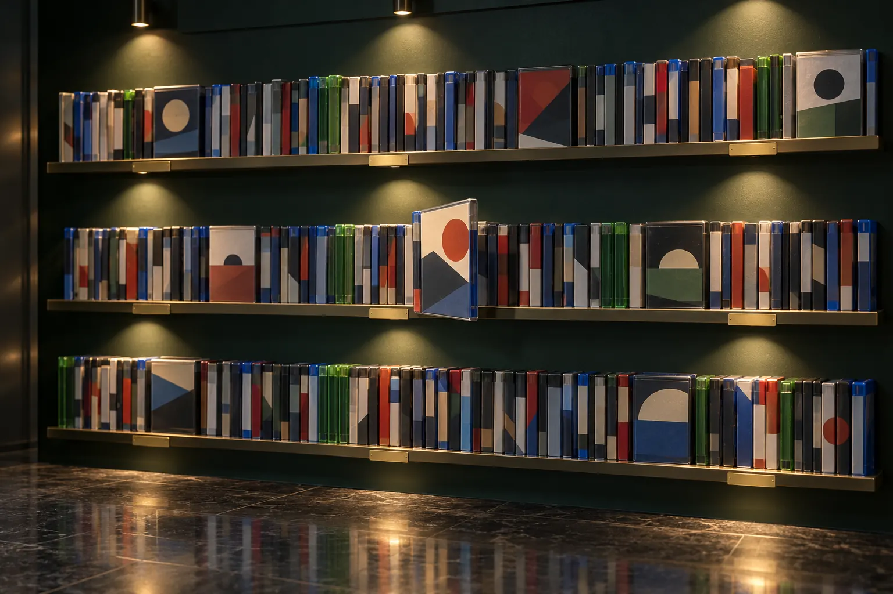
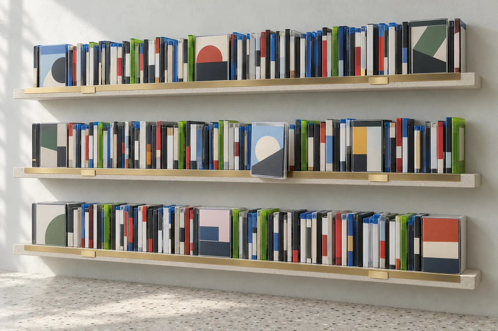
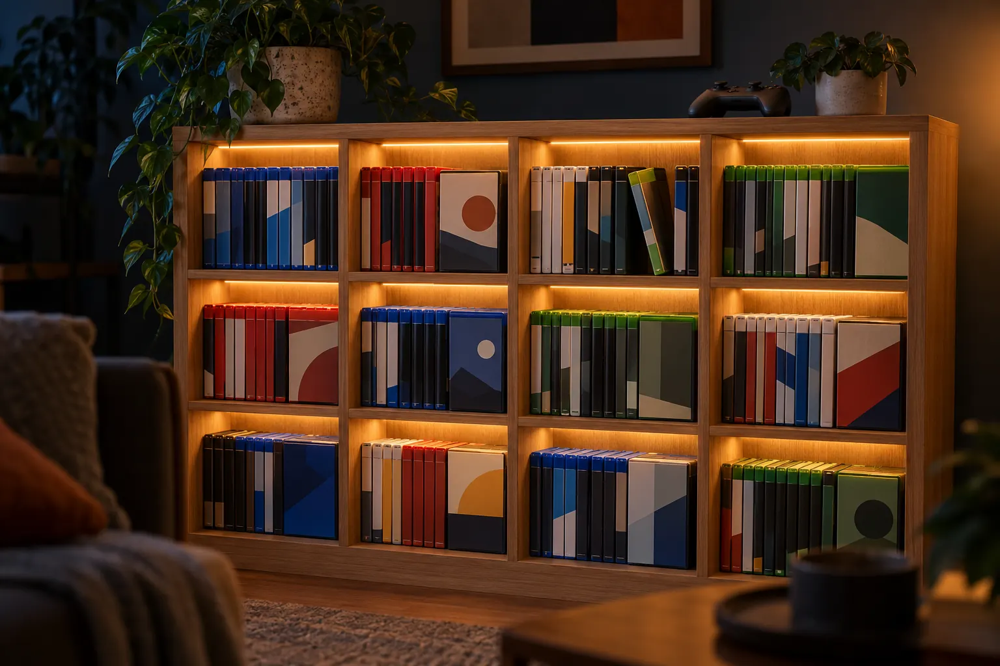
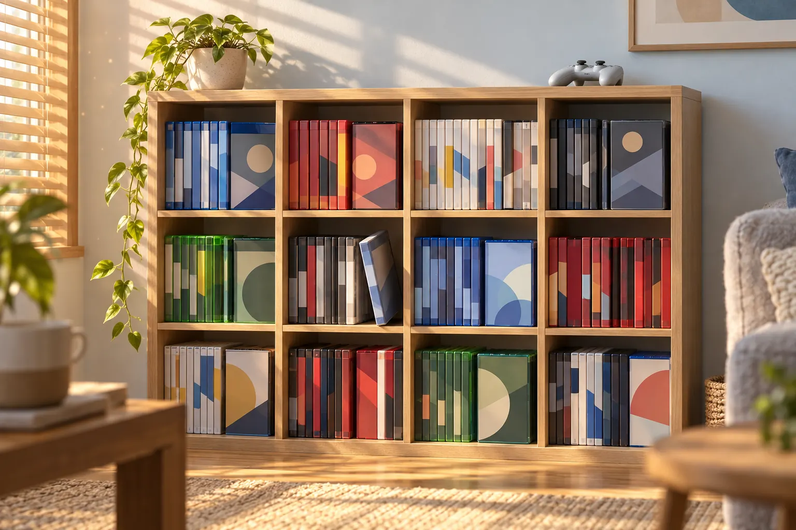
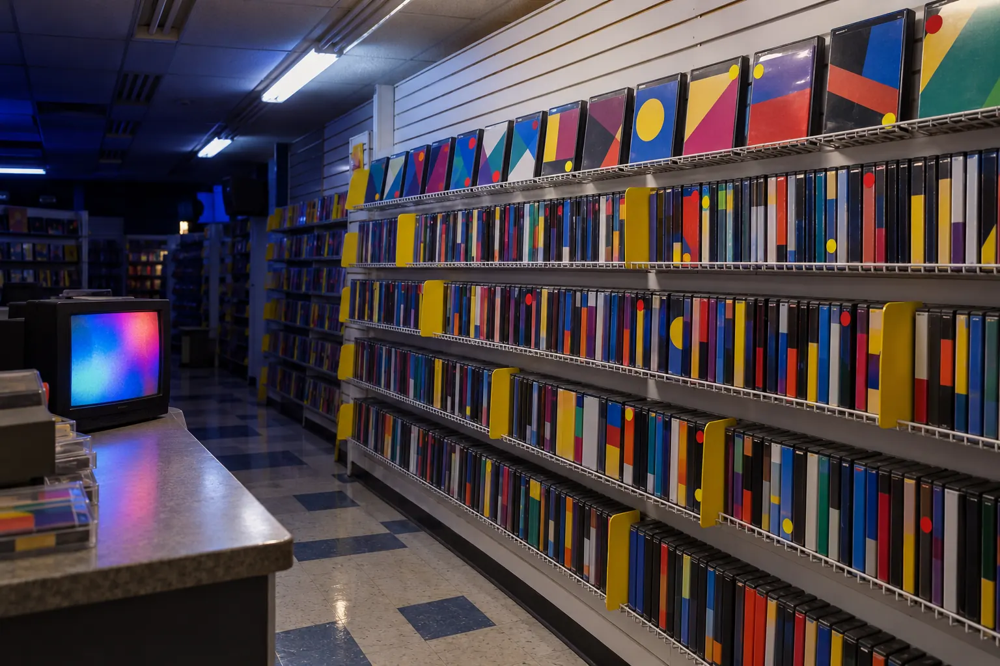
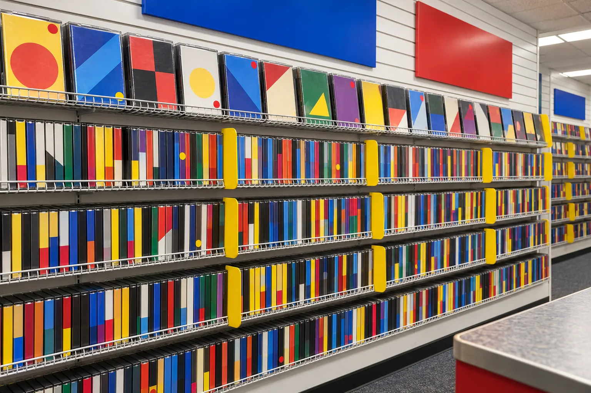

# Shelf: Phase 1 research

Research for a personal game library that should feel like standing in front of your own shelf.
No app code exists yet. This document ends with three visual directions and a recommendation.

**How this was gathered (12 Oct 2026).** I loaded each live site in a headless browser at
1440×900 (and 390×844 for mobile) and looked at the screenshots, read the linked sources, read
the reference app's code and docs, and made a few direct checks (HTTP headers on the IGDB image
CDN, a live IGDB query). Each claim below is marked where it matters:

- **Seen** means I observed it on the live site today.
- **Source** means it comes from the linked page, not from my own inspection.
- **Memory** means general knowledge I did not re-verify today. Treat it as a lead, not a fact.

Screenshots of third-party sites are not stored in this repo. The links are the record.

## Contents

1. [Award-level motion and landing pages](#1-award-level-motion-and-landing-pages)
2. [Game library UIs](#2-game-library-uis)
3. [3D and 2D shelf references](#3-3d-and-2d-shelf-references)
4. [Physical inspiration](#4-physical-inspiration)
5. [The reference app](#5-the-reference-app-myspot-games)
6. [Three visual directions](#6-three-visual-directions)
7. [Recommendation](#7-recommendation)
8. [Working assumptions](#8-working-assumptions)
9. [Sources](#9-sources)

---

## 1. Award-level motion and landing pages

### What each site does

| Site | What I saw | Technique worth taking |
| --- | --- | --- |
| [Linear](https://linear.app) | **Seen.** Near-black page. A two-line, left-aligned headline in a tight-tracked grotesque. The hero image is the product itself, in a hairline frame that runs off the bottom of the viewport. The next section opens with one long sentence whose first clause is white and the rest grey. Three columns split by hairlines, each with a wireframe drawing. | The product is the hero, not an illustration of it. Hierarchy comes from luminance steps of one colour, not from extra hues. One sentence can carry a headline and its explanation by changing tone halfway. |
| [Vercel](https://vercel.com) | **Seen, both themes.** Same layout in light and dark. In dark, the triangle mark is backlit by a white halo, like an eclipse. In light, the halo becomes a soft glow behind and the mark casts a drop shadow downward. Headline in a thin weight with negative tracking. | The theme switch changes where the light comes from and where the shadow falls. Nothing is merely inverted. This is the model for Shelf's themes. |
| [Stripe](https://stripe.com) | **Seen.** Light theme. A flowing gradient ribbon crosses the hero and passes behind the headline. Faint vertical guide lines frame the content column. Copy was served in pt-BR without asking. **Source:** developers widely believe the ribbon is a WebGL canvas, and note it is heavy on battery ([GSAP forum thread](https://gsap.com/community/forums/topic/24837-animating-gradients/)). | One moving element carries all the colour while the rest of the page stays quiet. Locale detection with no prompt. The battery note is a warning: ambient WebGL needs a pause when off-screen. |
| [Raycast](https://www.raycast.com) | **Seen.** A floating, rounded navigation capsule. Diagonal red light streaks with visible film grain behind a centred headline. | Grain over gradients hides banding and reads as light, not as a flat fill. |
| [Apple, MacBook Pro](https://www.apple.com/macbook-pro/) | **Seen.** Sticky local nav with the product name and a Buy button. Very large-radius black cards. Short, heavy headlines ("Take a closer look."). **Source:** tutorials that rebuild these pages describe the scroll-scrubbed product sequences as a canvas drawing numbered frames, pinned with `position: sticky` inside a container 200 to 500vh tall ([CSS-Tricks](https://css-tricks.com/?p=308477) is the best known). Apple's own code is not public. | Pin a stage, scrub a sequence with scroll, and time each caption to the range where it is true. Native scroll stays in charge, so it reverses cleanly. |
| [Igloo Inc](https://www.igloo.inc) | **Seen.** The whole page is one WebGL scene, pale and monochrome, with wireframe overlays. | Shows the ceiling for a 3D-first page, and its cost: nothing renders without WebGL. |
| [Godly](https://godly.website), [Awwwards](https://www.awwwards.com/websites/sites_of_the_day/), [Land-book](https://land-book.com) | **Seen.** All three are filterable walls of tiles, which is what Shelf is. Godly's previews move (two captures showed different frames of the same tiles) and it filters with one row of chips. Awwwards filters its 6,496 Sites of the Day by award, category, tag, technology, country, font and colour. Land-book has a chip row of page types, a Filters button and a sort menu, plus separate galleries for sections, motion and headlines. **Source:** a recent Awwwards Site of the Day, the [Lando Norris site](https://www.awwwards.com/sites/lando-norris) (17 Nov 2025), lists WebGL, GSAP and Webflow, and its highest developer score is Animations/Transitions at 8.60. | The same control layout on all three: chips for common filters, a panel for the rest, sort at the right. Awwwards' colour filter suggests one for Shelf, since cover colours are extracted anyway: filter by colour, or sort the shelf into a rainbow (**Memory:** a common collector arrangement). **Source:** the usual production stack for scroll-driven 3D is Lenis for smoothed scroll, GSAP ScrollTrigger for choreography and Three.js for the scene ([Codrops case study](https://tympanus.net/codrops/2026/05/06/from-shader-uniforms-to-clip-path-wipes-how-gsap-drives-my-portfolio/)), which is the stack the brief already names. |

### Techniques Shelf will use

**Scroll choreography.** One pinned stage on the landing page, scrubbed by scroll: the camera
travels along the shelf while captions change. Lenis supplies one smoothed scroll value and
shares a single animation frame with GSAP's ticker, so the two never disagree. Lenis is turned
off for touch input (native momentum is better) and under `prefers-reduced-motion`.

**Typography.** Large display type with tight tracking. Two-tone sentences in place of a
headline plus a subhead. Tabular numerals wherever numbers change (counts, hours).

**Micro-interactions.** Motion answers an action, lasts 150 to 250ms, and moves only `transform`
and `opacity`. No decoration on idle elements.

**Page transitions.** React's `<ViewTransition>` gives shared-element morphs with no animation
library. From the [Next.js guide](https://nextjs.org/docs/app/guides/view-transitions)
(v16.4, updated 10 Sep 2026, React 19.3):

- Wrap the shelf cover and the detail hero in `<ViewTransition name="game-{id}">`. Add
  `share="morph"` with `default="none"` so a named element does not crossfade on unrelated
  transitions.
- The guide uses 400ms for the morph and a 3px blur at 30% of the way through, which hides
  interpolation artefacts.
- Exits are fast (150ms) and enters slower (210ms, delayed until the exit ends).
- The morph only plays when the destination renders in the same commit as the navigation. So
  the detail view must already have its data: prefetch the route, or keep the game in the query
  cache. This is a real constraint on how the detail page loads.
- `::view-transition { pointer-events: none }` keeps the page clickable during a transition.
- Support: Chromium 125+, recent Safari and Firefox. Without support the page works and simply
  does not animate.

**Loading states.** A tiny blurred placeholder per cover, then the cover. Skeleton to content
through a Suspense reveal. Shelves fill in a short stagger, once, on first load only.

**Light and dark.** Linear and Vercel rebuild the luminance scale per theme. Vercel goes further
and moves the light. Shelf treats the theme as a lighting state (section 4).

**Reduced motion.** The Next.js guide's rule is the baseline: under
`prefers-reduced-motion`, positional movement goes away and short opacity changes stay.

---

## 2. Game library UIs

| Product | How it shows a collection | Filtering and sorting | What makes the collection feel valuable | Take for Shelf |
| --- | --- | --- | --- | --- |
| **Steam Library** | **Source:** the home screen is a stack of horizontal "shelves" (Recent, custom shelves per collection) that can be added, removed and reordered ([Steam](https://store.steampowered.com/libraryupdate)). | **Source:** "dynamic collections" are saved filters (genre, player count, controller support) that update as the library grows; each shelf has its own sort order, such as alphabetical or hours played ([PC Gamer](https://pcgamer.com/steam-library-redesign-date-preview), [TechSpot](https://techspot.com/news/81750-steam-library-revamp-arrives-september-17-streamlined-interface.html)). | Shelves you arrange yourself. | "Smart shelves" are Steam's dynamic collections. A shelf is a saved filter plus a sort. |
| **GOG Galaxy 2.0** | **Source:** one library across every launcher, in grid or list. | **Source:** filter by platform, rating, genre, your own tags and install state, then save the view as a sidebar "bookmark" ([Indie Hive review](https://indie-hive.com/gog-galaxy-2-closed-beta/)). | Everything you own in one place, whichever store sold it. | Saved filter views in the navigation. One library that is not organised by store. |
| **Playnite** | **Seen** on [playnite.link](https://playnite.link): desktop views plus a fullscreen mode with themes for controllers. Metadata comes from IGDB. **Memory:** grouping by platform, genre or completion status, and savable filter presets. | **Memory:** a filter panel covering nearly every field. | Playtime tracked per game; themes make the library your own. | Group-by as a first-class control. Completion status as a core field. |
| **PS5 home** | **Source:** a row of small tiles in the top-left corner so the selected game's art can fill the screen; each game opens a hub of cards ([GameRevolution](https://www.gamerevolution.com/features/662656-ps5-ui-user-experience-state-of-play)). | Almost none. | The whole room changes to the game you are looking at. | Selecting a game should change the ambient light and colour of the scene. |
| **Switch home** | **Source:** one row of large icons with very little chrome; only 12 games show before an "All Software" screen ([My Nintendo News](https://mynintendonews.com/2020/01/02/platinum-games-boss-isnt-a-fan-of-the-nintendo-switch-home-menu/)). | Almost none, which is its best-known complaint. | Big, calm, tactile. | Restraint and large touch targets. Also a warning: simplicity without organisation fails at 100+ games. |
| **Backloggd** | **Seen:** covers six across on desktop, with a count ("322,374 Games"), "Apply Filters" and "Sort by" as the only controls. | **Source:** sort by popularity, rating, time to play and time to finish ([changelog 1.15.2](https://backloggd.com/changelog/1_15_2)); advanced filters are still on the [roadmap](https://backloggd.com/roadmap/). | **Memory:** a journal, half-star ratings and lists, modelled on Letterboxd. Data from IGDB. | The filter gap is real. Strong filters are where Shelf can be better than the leader. |
| **HowLongToBeat** | **Seen:** search-first home page. **Memory:** backlog and completed lists with per-game times for main story, main plus extras, and completionist. | **Memory:** sort and filter by length. | Time as a planning tool: what can I finish this month? | IGDB has a `game_time_to_beats` endpoint (confirmed in its docs), so "time to beat" can be a filter and a sort without another data source. |
| **Letterboxd** | **Seen:** posters twelve across on desktop and four across on mobile, each with a hairline border. One line of small, muted controls (decade, genre, service, sort). A single count line. Nothing else. | **Seen:** four dropdowns in one row. | **Source:** the co-founder calls poster art the navigation itself ([Wix Studio](https://www.wix.com/studio/blog/letterboxd-ui-is-changing-movie-reviews)). **Memory:** four favourites on the profile, a diary, lists, yearly stats. | Contemplation comes from density plus restraint: many covers, almost no chrome, and a small set of things you chose to put first. |

### Patterns across all of them

1. **The art is the interface.** Every product that feels good shows covers large and chrome small.
2. **A shelf is a saved question.** Steam's dynamic collections and Galaxy's bookmarks are the
   same idea: a filter and a sort with a name.
3. **Value comes from curation and from time.** Favourites you picked, hours you spent, things
   you finished. Shelf's trophy wall and ambient stats belong here.
4. **Nobody shows spines.** I found no game library with a spine-out shelf. CLZ Games has a
   "Cover Wall" and a tablet "Cover Flow" ([manual](https://clz.com/games/mobile/manual/ios/2.0/en/topic/choosing-view-modes));
   the search turned up nothing spine-based in LaunchBox. A believable spine shelf is open ground.
5. **Filtering is weak almost everywhere.** Backloggd lists advanced filters as future work.
   Console home screens have none.

---

## 3. 3D and 2D shelf references

| Reference | What it is | What to take |
| --- | --- | --- |
| [Stripe Press](https://press.stripe.com) | **Seen.** WebGL books as real objects with thickness, cloth and foil, lying flat so the spine and a sliver of cover show. Warm, very dark background. A column of tick marks at the left works as an index of the books. Serif type. | Believable thickness and material are what sell the object. The tick column is a scrub bar for a long shelf, and a natural keyboard and screen-reader landmark. |
| [The Complete Shelf](https://github.com/mengto/complete-shelf) | **Source.** A single-file Three.js shelf of seven hardbacks. Pulling a volume runs a small state machine: shelf, opening, closed inspection, open book, closing, shelf. Transforms run on "deterministic eased timelines" with "exact endpoints", so moving the book between scene graphs never jumps. Cloth, foil, paper and wood are canvas textures made at runtime. HTML controls and status announcements sit over the canvas. | A state machine with exact endpoints for the pull-out. A real HTML layer over the canvas for accessibility. Procedural textures to keep downloads small. No licence is stated, so ideas only, no code. |
| [MyShelves](https://myshelves.eu) | **Source** ([three.js forum](https://discourse.threejs.org/t/myshelves-a-first-person-library-you-build-book-by-book/93870)). A first-person library in react-three-fiber. The author's rule: "Draw calls, never triangles, are the budget." One book is four boxes and about 19 draw calls. `shadowMap.autoUpdate = false`, with a manual update only when something moves, was a major gain. Spine art is a strip cut from the cover's left edge. **Seen:** in my headless browser (software rendering, no GPU) its menu ran at 4 fps. | Instancing is mandatory. Shadows must not update every frame. And 3D has to be optional: with no GPU it is unusable, so detection and a first-class 2D view are requirements, not extras. |
| [Marius Balaj's bookshelf](https://balajmarius.com/bookshelf/) | **Seen.** 486 books in plain DOM. A **Shelf / Stack toggle** switches between two physical arrangements. Each spine is a flat bar in the cover's dominant colour, with the cover inset near the top and the title running vertically. Heights vary. | The closest thing to Shelf's 2D view. Dominant-colour spines solve the missing spine art. A two-state arrangement toggle is proven to read well. 500 DOM spines is fine. |
| [Petar Gyurov's bookshelf](https://petargyurov.com/bookshelf/) | **Seen.** Pure CSS spines on a thin line, grouped by year, with random widths and heights. **Slanted books are the ones he did not finish.** | Status shown as posture. A shelf line and a heading are enough to make a group. |
| [Digging Into Hip-Hop](https://thenextweb.com/news/site-lets-dig-favorite-records-golden-era-hip-hop), [Not The Final Vinyl](https://contra.com/p/OcAM62MW-not-the-final-vinyl-record-label-as-instrument) | **Source.** Three.js record crates. Wheel, arrow keys and drag all move through the crate; pulling a record shows its detail. In the second, the record slides out of its sleeve as a separate mesh. | Wheel, keys and drag must all do the same thing. The pulled object is its own mesh. |

### What keeps them fast, turned into a budget for Shelf

**Draw calls.** The react-three-fiber docs say to stay at "a few hundred or less" and never
above about 1,000, and show 100,000 instances in one call
([scaling performance](https://r3f.docs.pmnd.rs/advanced/scaling-performance)). Shelf uses one
`InstancedMesh` per case shape (about eight shapes, section 4). A thousand games is under 20
draw calls for the boxes.

**Textures are the real limit.** Uncompressed in GPU memory, one `cover_big` (264×374) is about
0.4 MB, or 0.5 MB with mipmaps. Five hundred of them is roughly 260 MB, which a phone cannot hold.
So covers load by distance:

| Distance | Texture | Cost for 500 games |
| --- | --- | --- |
| Every box, always | Spine atlas, generated (about 24×256 px each) | One 2048² texture |
| Mid-distance, face-out | `cover_small` (90×128), packed in atlases | Two 2048² textures |
| The dozen nearest | `cover_big` (264×374) | About 6 MB |
| The one pulled out | `cover_big_2x` or `720p` | About 2 MB |

**Two facts I checked on the IGDB image CDN today:**

- Every response carries `access-control-allow-origin: *` and
  `cache-control: public, max-age=31536000, immutable`. WebGL can use the images as textures
  directly, with no proxy and no load on Vercel's image optimiser.
- Changing `.jpg` to `.webp` works. `.avif` returns an error. So WebP comes free from the CDN,
  and AVIF would need Vercel's optimiser.

**There is no spine art.** IGDB has covers, screenshots and artworks, and nothing for spines.
Spines must be generated: a platform band, the title in a condensed face, and a colour taken
from the cover. This is the same answer Balaj and MyShelves reached. The dominant colours are
extracted once, when a game is added, and stored with it.

**Rendering.** `frameloop="demand"` so an idle shelf costs nothing. Pixel ratio capped (1.5 on
phones, 2 on desktop). `PerformanceMonitor` steps quality down when the frame rate drops. No
real-time shadows: contact shadows are baked planes. Textures are disposed when the view
unmounts, because JavaScript garbage collection does not free GPU memory.

**Loading.** The Three.js bundle is fetched only when the 3D view opens. The 2D view ships none of it.

**2D.** Only `transform` and `opacity` animate. The 3D flip is applied to the one spine being
hovered or tapped, never to all of them. Off-screen shelves use `content-visibility: auto`, and
rows are virtualised past about 1,000 games.

---

## 4. Physical inspiration

### Cases are not one shape

Real shelves look real because the boxes differ. Dimensions from
[Wikipedia's keep case article](https://en.wikipedia.org/wiki/Keep_case) (height × width × thickness):

| Case | Size (mm) | Colour | Used by |
| --- | --- | --- | --- |
| DVD-size keep case | 190 × 135 × 15 | Mostly black | PS2, Xbox, Xbox 360, PC DVD, GameCube outside Japan |
| Wii, Wii U | 190 × 135 × 14 | White; bright cerulean | Wii, Wii U |
| Blu-ray-size case | 171.5 × 135 × 13 | Translucent blue (PS4, PS5), translucent white (PS3), translucent green (Xbox One, Series) | PS3, PS4, PS5, Xbox One, Xbox Series |
| Switch | 170 × 104 × 10 | Clear; red for Switch 2 | Switch, Switch 2 |
| DS, 3DS | 135 × 122 × 15; × 12 | Black or clear; white | DS, 3DS |
| PS Vita | 135 × 105 × 12 | Blue | Vita |
| PSP (UMD) | 168 × 99 × 14 | Clear | PSP |
| CD jewel case | 142 × 125 × 9.9 | Clear with a dark tray | PS1, Saturn, Dreamcast, PC CD |

Sizes and platform colours are from the article. Which consoles used the DVD-size, Blu-ray-size
and jewel cases is **Memory**: the article gives the Blu-ray size for films and does not list
PlayStation or Xbox cases separately.

Cartridge-era cardboard boxes (NES, SNES, N64, Game Boy) and Mega Drive clamshells are not in
that article, and my search found no reliable figures. They need measuring from reference
photos in the spec phase. Digital-only games have no box at all, which is a design question the
spec must answer (section 6 proposes one per direction).

**Spine anatomy** (**Memory**, consistent across platforms): a platform band at the top, the
title running top to bottom, the publisher's mark at the foot. Shelf's generated spine follows
the same order with a platform colour band, the title, and the studio name. Platform names are
set as text. No trademarked logos are drawn.

### How collectors arrange shelves

**Memory**, from years of collection photos; the concept images in section 6 reflect it:

- Spine-out for density, face-out for the few you are proud of. Retail calls this "facing".
- Grouped by platform first, then alphabetical or by series. Platform groups read as bands of
  colour: a blue run, a green run, a red run.
- Cube shelving, with about two dozen standard cases to a bay.
- A light strip under each shelf, usually warm white.
- Objects on top: a controller, a plant, a figure.
- The gesture for taking a game: a fingertip hooks the top of the spine and tips it forward.

### Museum and gallery lighting

From the lighting guides ([Art Basel on ERCO](https://www.artbasel.com/stories/how-light-shapes-the-experience-of-art-erco-lighting),
[LEDYi](https://www.ledyilighting.com/a-definitive-guide-to-museum-lighting/),
[PacLights](https://www.paclights.com/explore/lights-for-paintings-galleries-what-engineers-need-to-know/)).
Most of these are vendor guides, so I take only the points they agree on:

| Principle | Source figure | In Shelf |
| --- | --- | --- |
| Accent light dominates; ambient stays low | No ratio given | Dark theme: each shelf bay has its own pool of light and the wall between pools falls away |
| Warm white on objects | About 3000K | The dark theme's spot colour, roughly `#FFD6A5` |
| High colour fidelity | CRI 90 or above | Covers are never tinted by the UI. Light changes brightness, not hue. |
| Narrow beams for objects, wide for the room | 15 to 30° and 40°+ | Dark theme uses narrow pools. Light theme uses one wide, soft wash. |
| Control glare | Louvres and lenses | No specular hot spots on covers; reflections stay on the ledge and floor |

**The theme is a lighting state.** Light theme is a daylit room: one large soft source, long
gentle shadows, cool fill. Dark theme is the same room at night: small warm sources, pools,
deep falloff. Materials respond (brass glows at night and goes matte by day), and contact
shadows change shape. Colours are not inverted.

---

## 5. The reference app (MySpot Games)

Read-only study of `~/platform/apps/games` and `~/platform/packages/db`. Nothing was changed
there. It is a multi-user tracker: Next.js 16, React 19, Tailwind v4, shadcn/ui, Postgres with
Drizzle, Inngest jobs, self-hosted. Dark only, with a neon look.

### Features

Accounts and public profiles. A per-user library with table, grid, banner and CSS-3D shelf
views. Eleven statuses in four groups. A manually ordered backlog. IGDB search. Score out of
100, hours, start and finish dates, review, favourite, private flag. Steam and PlayStation sync
for owned games, wishlist, playtime and achievements. Collections. Community reviews with votes.
Stats and a trophy case. Public game pages. CSV export. Fourteen filter facets, three ranges and
four flags, with include and exclude per value, all encoded in the URL and run in SQL.

### Data model

| Table | Holds |
| --- | --- |
| `games` | The shared catalogue, one row per IGDB game (371,279 rows): uuid, `slug`, `igdb_id`, title, release date, `game_type`, cover and banner ids, ratings, `version_parent_id`. |
| `igdb.*` | A full mirror of IGDB: 54 endpoints, about 6.2 million rows. |
| `game_facets` | A materialised view with ten arrays per game (genres, themes, platforms, modes, perspectives, developers, publishers, franchises, DLC and expansion ids). |
| `library_entries` | One row per user per game, `UNIQUE (user_id, game_id)`: `status`, `score`, `custom_hours`, `review`, dates, `favorite`, `is_private`, `sort_order`, `parent_entry_id`, and **`played_on text[]`**. |
| `library_synced_hours` | Playtime per `(entry, provider)`. |
| `library_synced_achievements` | Achievement progress per `(entry, provider)`. |

### How it uses IGDB

It began as a request-time proxy that created catalogue rows on demand, and became a complete
local mirror. A nightly delta costs about 130 requests, a monthly full re-read about 13,000.
Search runs locally on trigrams and never calls IGDB.

Worth copying:

- **The rate limit lives in the client.** Each call reserves the next time slot with no `await`
  in between, so any number of concurrent callers share one ceiling. It runs at 2.5 requests per
  second, below IGDB's limit of 4 (and 8 open requests), on purpose.
- **One token request at a time.** Concurrent callers share a single in-flight promise.
- **Retries back off** exponentially with jitter and honour `Retry-After`.
- **Images stay on IGDB's CDN.** They measured 0.24s direct against 1.20s through
  `/_next/image`. A custom loader picks a larger or smaller token within one family.
- **Size tokens come in families that crop differently.** `cover_*` keeps the aspect ratio,
  `screenshot_*` crops to 16:9, `thumb` crops square. Switching family re-crops the picture.
- **The URL is the filter state.** Multi-value facets are repeated keys
  (`?genre=RPG&genre=Shooter`), never comma-joined, because studio names contain commas. Every
  value is clamped, and a bad value falls back to the default.
- **Exclusion is a separate list**, not a minus sign on a value, because a studio can be named
  "-Nerve-".
- **One definition of what counts as a game**, shared by search and by the library filter.
- **IGDB's own quirks:** id 0 is a real row in some tables, and some dates are outside what a
  database can store.

Not worth copying: the mirror. Shelf is one person's library of a few hundred games. It should
cache the games I own, and nothing else. IGDB's FAQ says storing data locally is allowed and
preferred.

### What goes wrong for a game owned on several platforms

This is the part that decides Shelf's data model. Each point cites the code.

1. **Identity is an IGDB record, and IGDB splits one game into several records.** A live query
   today for "Shadow of the Tomb Raider" returned the game (id 37777) and "Shadow of the Tomb
   Raider: Ultimate Edition" (id 99123, whose `version_parent` is 37777) as two rows, both of
   type "Main Game". Search hides editions with `version_parent_id IS NULL`
   (`lib/db/search.ts:95`), but sync resolves a store's id to whichever record claims it. The
   app's guide gives the example: "a PSN entitlement for Spider-Man resolves to the GOTY
   Edition" (`AGENTS.md:820-822`). The same game owned on Steam and on PlayStation can
   therefore become two entries, each with its own status, score and hours. (This follows from
   the code. I did not query the production data to count how often it has happened.)
2. **A duplicate cannot be merged in the UI.** `UNIQUE (user_id, game_id)` turns the fix into
   a merge of two sets of progress. The guide describes the same duplicate arising when IGDB
   itself merges two records: "Steam sync creates the entry on the good row while the manual add
   sits on the duplicate", and it expects that conflict "to be the common case, not the rare
   one". The merge function exists (`lib/db/migrateEntry.ts`); the interface for it does not
   (`AGENTS.md:1310-1325`).
3. **Platforms owned are not modelled.** `played_on` is a list of nine coarse families ("PC",
   "PlayStation", "Handheld"). It was the entry's own `platforms` column until a rename
   (migration `20260612160000_played_on.sql`), and it means "where I played it", not "what I
   own". It cannot tell PS4 from PS5, is not linked to
   IGDB's platform ids, and has nowhere to put physical or digital, edition, store or purchase
   date. Nothing in the app records physical or digital at all.
4. **Ownership is recorded in three places that disagree.** A sync writes `played_on` only when
   it first inserts an entry (`inngest/functions.ts:181-188`, then
   `ON CONFLICT DO NOTHING` in `lib/db/sync.ts:171`). An entry created by Steam and later found
   on PlayStation keeps `played_on = ['PC']` unless I edit it by hand; the PlayStation copy
   exists only as a row in `library_synced_hours`. That table also stores zero-hour rows to mean "wishlisted here"
   (`functions.ts:235-256`), so a playtime table is doing double duty as an ownership table.
5. **Sync data is keyed by provider, not by platform.** PSN covers PS4 and PS5. Steam covers
   Windows, Mac, Linux and the Deck. When two store ids resolve to one game, the hours are
   combined with `Math.max` (`functions.ts:114-124`), so one of the two is discarded.
6. **Manual hours are one number per entry** (`custom_hours`). Playing a game on two systems by
   hand cannot be recorded.
7. **Achievement totals needed a special case** to avoid counting one game twice across
   platforms (`DESIGN_BRIEF.md`, section 4g).

**What Shelf does about it** (the full argument goes in `docs/adr/001-game-entry-model.md` in
Phase 2):

- One entry per game as I think of it. The entry points at the IGDB parent record and also
  keeps the ids of its editions, remasters and ports as aliases, so a future sync that resolves
  to "Ultimate Edition" lands on the same entry.
- Platforms owned are rows under the entry, one per platform, keyed by IGDB platform id, each
  with physical or digital, and room for edition, store and purchase date.
- Future sync sources attach to an ownership row, not to the entry, so per-platform playtime
  and achievements have a home from the start. None of it is built now.

---

## 6. Three visual directions

Rules that hold in all three:

- **The games supply the colour.** Five hundred covers are loud. The chrome stays quiet.
- **The theme is a lighting state** (section 4).
- **Spines are generated** from the cover's colours and the title (section 3).
- **Cases keep their real shapes** (section 4), chosen by the platform I own the game on.
- The reference app is dark-only neon, with a planned lime-on-black redesign. None of the three
  goes near either.

All concept images were generated with Codex. The cases carry abstract placeholder art only:
no game covers, logos or text. Prompts are in
[`design/assets/PROMPTS.md`](../design/assets/PROMPTS.md).

### A. Vitrine

**Mood.** A museum's open storage: the collection kept on long ledges where visitors can see
all of it, lit the way a museum lights objects. Quiet and exact. The message is that this
collection is worth keeping well.

| | Dark: after hours | Light: daylight |
| --- | --- | --- |
| Wall | `#17231F` deep viridian | `#ECEEEA` pale lichen plaster |
| Surface | `#1F2F29` | `#F8F9F6` |
| Ledge | Blackened steel `#0C1411`, brass lip | Honed limestone `#D5D8D1`, brass lip |
| Text | `#EEF1EA` | `#171B18` |
| Secondary text | `#A7B2A9` | `#56605A` |
| Brass (accent, labels, focus) | `#D9B26A` | `#7A5C1E` |
| Marker for "playing" | `#F0705E` | `#B5382A` |
| Light | Narrow warm pools, about 3000K | One wide, soft skylight |

Every text pair above passes WCAG AA (lowest is 4.5:1, secondary text on the ledge).

**Type.** [Newsreader](https://fonts.google.com/specimen/Newsreader) for game titles and
display, with its optical sizes and real italics, the way a wall label sets an object's title.
[Archivo](https://fonts.google.com/specimen/Archivo) for the interface and for spines: its
width axis runs from 62 to 125, so one family is condensed on a 13mm spine and normal in a menu.

**Motion.** Museum pace. The camera dollies on long ease-in-out curves (700 to 900ms). Pulling
a game narrows the light onto it: everything else dims and softens, the game turns to face you.
Reordering lifts each box a few millimetres, slides it and sets it down, with a short stagger.
Switching theme changes the lights over about a second: the skylight fades and the spots warm
up. In dark theme the bay in front of you is brightest, as if the lights followed you down the
aisle. Calm alternative: crossfades of 200ms or less, no camera travel, lights change at once.

**3D shelf.** Long floating ledges on a plain wall. Brass label plates on the ledge lip name
each group and its count. The floor takes a faint reflection. The camera tracks sideways along
the wall; a few favourites stand face-out. A digital-only game is a slim acrylic block with the
cover printed on its face: present on the shelf, clearly not a box.

**2D shelf.** The same wall seen straight on. Each ledge is a strip with a top-down light
gradient and a soft contact shadow. Wall, ledge and spines move at slightly different rates on
scroll. Tapping a spine slides it forward and swings it round its edge to show the cover, and
the light pool brightens.

**Risks.** Can turn cold or precious. Deep green with brass and a serif can drift toward a
whisky label; the fix is modern proportions and plain language (statuses stay "Backlog",
"Playing", "Completed", with no museum jargon).

### B. Golden Hour

**Mood.** The shelf at home. Oak cubes, a plant, a controller on top, light strips under each
shelf. Warm, lived-in, personal. The message is that this is yours.

| | Dark: lamp-lit evening | Light: sunny morning |
| --- | --- | --- |
| Wall | `#131A26` blue-hour navy | `#E4EAEE` pale blue-grey |
| Surface | `#1C2533` | `#FFF3D6` where the sun lands |
| Shelf | Walnut in lamplight `#5A3A22` | White oak `#D9BE94` |
| Text | `#F3EDE2` | `#1B2430` |
| Secondary text | `#ABB3C0` | `#55606E` |
| Accent | Lamplight `#FFB45C` | Denim `#2B4C8C` |
| Light | 2700K strips under each shelf, one floor lamp | Low sun through blinds, cool shadows |

Text pairs pass AA on the wall colours. Secondary text does not pass on oak (3.6:1), so text on
wood always uses the primary colour.

**Type.** [Bricolage Grotesque](https://fonts.google.com/specimen/Bricolage+Grotesque) for
display and spines (it has width and optical-size axes and a warm, slightly irregular voice).
[Instrument Sans](https://fonts.google.com/specimen/Instrument+Sans) for the interface.

**Motion.** Weight and springs. A hovered game tips forward from the top, as if a fingertip had
hooked the spine. Dragging has inertia. Bars of sunlight drift across the shelves over minutes.
Switching theme is a sunset: the light slides sideways and warms, then the strips come on one
bay at a time. Calm alternative: no springs or overshoot, short eases, still light.

**3D shelf.** A cube unit standing in a room, seen from where you would stand. Blind shadows
fall across the spines by day; strips glow by night. Objects sit on top of the unit. A
digital-only game is a slim card in a small stand.

**2D shelf.** The unit seen from the front: a grid of bays with a wooden frame and an inner
shadow. A moving gradient stands in for sunlight, an inner glow for the strips. Tapping a spine
tips it out and flips it to the cover.

**Risks.** Wood-grain shelves recall the skeuomorphic apps of 2010 if the rendering is less
than excellent, and good wood costs texture memory. The room competes with the games for
attention. The light theme sits close to the warm-cream look that many current sites share.

### C. Locadora

**Mood.** *Locadora* is Brazilian Portuguese for a rental shop: the neighbourhood game rental
place of the 1990s. Slatwall packed to the ceiling,
yellow shelf tabs, price stickers, a CRT on the counter. Loud, dense, nostalgic, a little
funny. The message is abundance.

| | Dark: closing time | Light: Saturday afternoon |
| --- | --- | --- |
| Wall | `#141338` deep indigo | `#F4F5F7` white slatwall |
| Surface | `#1E1D4D` | `#FFFFFF` |
| Text | `#EDF2FF` | `#14161A` |
| Secondary text | `#A9B0D6` | `#586070` |
| Shelf-tab yellow (always with dark text) | `#FFD21F` | `#FFD21F` |
| Blue | `#8EA2FF` | `#1746D1` |
| Red | `#FF6B5E` | `#C9271F` |
| Light | Half the tubes off, cool bands, CRT glow | Bright, even, cool fluorescent |

All text pairs pass AA.

**Type.** [Big Shoulders](https://fonts.google.com/specimen/Big+Shoulders) for display and
spines: a condensed gothic, which is what shop headers and spines both want. [Familjen Grotesk](https://fonts.google.com/specimen/Familjen+Grotesk) for the interface.

**Motion.** Fast and mechanical, 120 to 220ms. Shelf tabs swing when touched. Counters roll
like a tally counter. Reordering looks like someone re-shelving in a hurry. Switching theme is
one soft flicker of the tubes (a single dip, well inside the WCAG limit on flashing). Calm
alternative: plain fades.

**3D shelf.** A slatwall with wire racks. Top row face-out, lower rows spine-out. Groups are
marked by yellow tabs sticking out between sections. Status shows as round stickers. A
digital-only game is a membership-card-sized sleeve hung on a peg.

**2D shelf.** A flat, graphic wall: spines as bold colour bars, yellow tabs as group headers,
stickers for status. The least 3D of the three in its 2D form, and the most poster-like.

**Risks.** The busiest chrome of the three, next to the busiest content. Charming for a month
and tiring for a year. A shop is somebody else's stock, which works against "my own shelf".

### Side by side

My assessment, not measurements.

| | A. Vitrine | B. Golden Hour | C. Locadora |
| --- | --- | --- | --- |
| Feeling | Reverent | Cosy | Playful |
| Chrome next to covers | Quietest | Medium | Loudest |
| Theme change | Skylight to spotlights | Sunrise to lamplight | Tubes on to tubes half off |
| 3D cost | Lowest: flat wall, fake light pools | Highest: wood, room, props | Medium: many decals |
| 2D translation | Direct: a lit strip | Good: a grid of bays | Good: flat and graphic |
| Daily use over years | Wears well | Wears well | Likely to tire |
| Distance from the reference app | Far | Far | Medium (saturated, retro) |

---

## 7. Recommendation

**Build A, Vitrine, and borrow two things from the others.**

Why Vitrine:

1. **It does what the brief asks of themes better than the others.** Daylight against
   spotlights is a change of lighting, materials and shadow by definition.
2. **It makes the collection look valuable**, which is the job. Museum lighting does that to
   anything placed under it.
3. **It is the quietest frame** for 500 covers that share no palette.
4. **It is the cheapest to render well.** A flat wall, ledges, and light pools that can be
   gradients. That leaves the 3D budget for the boxes, and it is the direction most likely to
   hold 60fps with 500+ games and to look the same in 2D.
5. **It ages well** for something opened every week for years.

What to borrow:

- **From Golden Hour:** the fingertip tip-out as the hover and focus state, and warmth in the
  materials (the spot colour, the brass, a stone ledge that is not grey).
- **From Locadora:** density as a virtue, and one playful status marker (a small foil seal on
  completed games) so the shelf is not solemn.

If Vitrine feels too formal when you see it, the fallback is B's room around A's lighting
discipline. I would not build C as the main direction, though its sticker and tab vocabulary
could return later as an optional theme.

---

## 8. Working assumptions

Defaults I have taken so far. Any of them can change before Phase 2.

| Topic | Default |
| --- | --- |
| Repository | Private, `ldallacqua/shelf`, default branch `main`, one branch and pull request per phase |
| Tooling | pnpm and Node 24, both already on this machine |
| Scope | One library, mine. No user accounts beyond the single GitHub login |
| Statuses | The five in the brief: backlog, playing, completed, dropped, wishlist |
| My rating | Ten points in half steps, stored 0 to 100 so it sorts on the same scale as IGDB's rating |
| Playtime | Stored in minutes, shown in hours |
| IGDB | Cache on add, no mirror. Covers served from IGDB's CDN. Attribution to IGDB.com in the footer of every page |
| Which box a game shows | The first platform I own it on, changeable per game |
| Digital-only games | Shown on the shelf in a distinct form, not hidden |
| Languages | English is the source. pt-BR written alongside it, informal register |
| Sound | None |
| Analytics | None |
| Domain | The default `*.vercel.app` address until you name one |
| Local port | 3300, since 3000 and 8000 are used by other services on this machine |
| Generated assets | Optimised files committed; raw PNGs are not |

---

## 9. Sources

**Motion and landing pages**

- [Linear](https://linear.app), [Vercel](https://vercel.com), [Stripe](https://stripe.com), [Raycast](https://www.raycast.com), [Apple MacBook Pro](https://www.apple.com/macbook-pro/), [Igloo Inc](https://www.igloo.inc)
- [Godly](https://godly.website), [Awwwards Sites of the Day](https://www.awwwards.com/websites/sites_of_the_day/), [Land-book](https://land-book.com), [Awwwards: Lando Norris](https://www.awwwards.com/sites/lando-norris)
- [Next.js: Designing view transitions](https://nextjs.org/docs/app/guides/view-transitions)
- [Codrops: How GSAP drives my portfolio](https://tympanus.net/codrops/2026/05/06/from-shader-uniforms-to-clip-path-wipes-how-gsap-drives-my-portfolio/)
- [CSS-Tricks on the AirPods Pro scroll sequence](https://css-tricks.com/?p=308477)
- [GSAP forum: animating gradients](https://gsap.com/community/forums/topic/24837-animating-gradients/)
- [A critique of the Linear website](https://anthonyhobday.com/blog/20230119.html)

**Game libraries**

- [Steam library update](https://store.steampowered.com/libraryupdate), [PC Gamer preview](https://pcgamer.com/steam-library-redesign-date-preview), [TechSpot](https://techspot.com/news/81750-steam-library-revamp-arrives-september-17-streamlined-interface.html)
- [GOG Galaxy 2.0 announcement](https://cdprojekt.com/en/media/news/gog-galaxy-2-0-all-your-games-and-friends-in-one-place/), [Indie Hive beta review](https://indie-hive.com/gog-galaxy-2-closed-beta/)
- [Playnite](https://playnite.link), [Playnite theme docs](https://api.playnite.link/docs/tutorials/themes/introduction.html)
- [Backloggd](https://backloggd.com/games/lib/popular/), [changelog 1.15.2](https://backloggd.com/changelog/1_15_2), [roadmap](https://backloggd.com/roadmap/)
- [HowLongToBeat](https://howlongtobeat.com)
- [Letterboxd](https://letterboxd.com/films/popular/this/week/), [Wix Studio on Letterboxd's UI](https://www.wix.com/studio/blog/letterboxd-ui-is-changing-movie-reviews)
- [GameRevolution on the PS5 UI](https://www.gamerevolution.com/features/662656-ps5-ui-user-experience-state-of-play), [My Nintendo News on the Switch menu](https://mynintendonews.com/2020/01/02/platinum-games-boss-isnt-a-fan-of-the-nintendo-switch-home-menu/)
- [CLZ Games view modes](https://clz.com/games/mobile/manual/ios/2.0/en/topic/choosing-view-modes)

**Shelves in 3D and 2D**

- [Stripe Press](https://press.stripe.com)
- [The Complete Shelf](https://github.com/mengto/complete-shelf)
- [MyShelves](https://myshelves.eu), [author's write-up](https://discourse.threejs.org/t/myshelves-a-first-person-library-you-build-book-by-book/93870)
- [Marius Balaj's bookshelf](https://balajmarius.com/bookshelf/), [Petar Gyurov's bookshelf](https://petargyurov.com/bookshelf/)
- [Digging Into Hip-Hop](https://thenextweb.com/news/site-lets-dig-favorite-records-golden-era-hip-hop), [Not The Final Vinyl](https://contra.com/p/OcAM62MW-not-the-final-vinyl-record-label-as-instrument)
- [react-three-fiber: scaling performance](https://r3f.docs.pmnd.rs/advanced/scaling-performance)

**Physical**

- [Wikipedia: Keep case](https://en.wikipedia.org/wiki/Keep_case)
- [Art Basel: how light shapes the experience of art](https://www.artbasel.com/stories/how-light-shapes-the-experience-of-art-erco-lighting), [LEDYi museum lighting guide](https://www.ledyilighting.com/a-definitive-guide-to-museum-lighting/), [PacLights](https://www.paclights.com/explore/lights-for-paintings-galleries-what-engineers-need-to-know/)

**IGDB**

- [IGDB API docs](https://api-docs.igdb.com/): rate limits, image sizes, the storage FAQ, `game_time_to_beats`, `version_parent`
